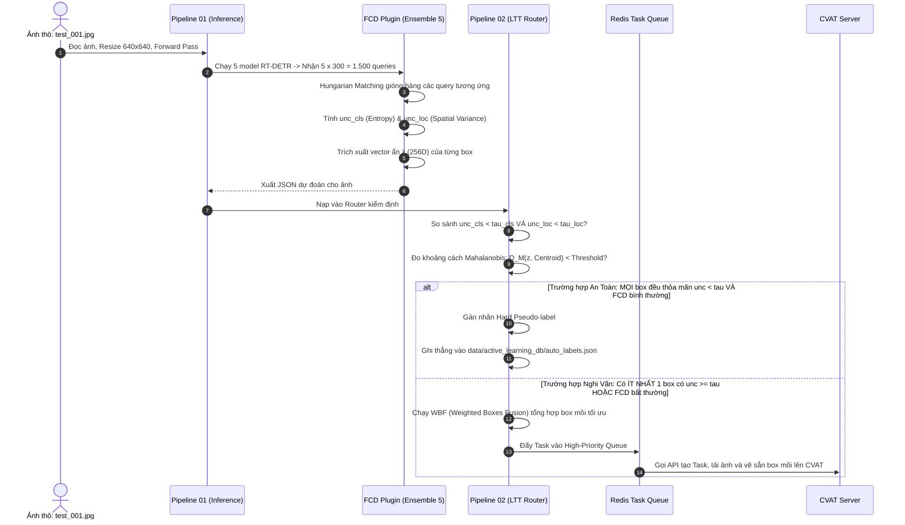
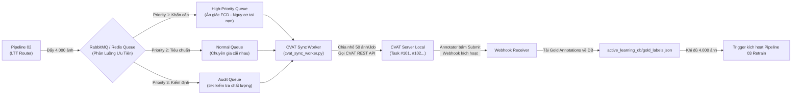

# MASTER SPECIFICATION: MODULAR RISK-CONTROLLED ACTIVE LEARNING PIPELINE (EXTRA PLAN v2.5)
**Hệ Thống Lọc Điểm Mù Tự Động, Điều Phối Gán Nhãn & Tái Huấn Luyện Chuẩn Doanh Nghiệp (M29 AI-Router & M35 Benchmark)**

---

## MỤC LỤC
1. [Triết Lý Thiết Kế & Bản Chất Các Quyết Định Kỹ Thuật (Design Rationale & Quantitative Grounding)](#1-triết-lý-thiết-kế--bản-chất-các-quyết-định-kỹ-thuật)
   * [1.1. Tại sao là 5 Model mà không phải 3, 7 hay 10?](#11-tại-sao-là-5-model-mà-không-phải-3-7-hay-10)
   * [1.2. Tại sao là Deep Ensemble Đồng Nhất mà không phải Heterogeneous?](#12-tại-sao-là-deep-ensemble-đồng-nhất-mà-không-phải-heterogeneous)
   * [1.3. Tại sao chọn 1 trong 5 Chuyên Gia làm Base Model thay vì Train mới?](#13-tại-sao-chọn-1-trong-5-chuyên-gia-làm-base-model-thay-vì-train-mới)
   * [1.4. RT-DETR, 2 Chiều Bất Định & Plugin Architecture](#14-rt-detr-2-chiều-bất-định--plugin-architecture)
2. [Cơ Chế Lọc 2 Loại Ảnh Khó Không Cần Ground Truth (FCD & LTT Mechanics)](#2-cơ-chế-lọc-2-loại-ảnh-khó-không-cần-ground-truth)
3. [Quản Trị Dữ Liệu & Quy Tắc Quản Lý Tập Calibration (Data Governance)](#3-quản-trị-dữ-liệu--quy-tắc-quản-lý-tập-calibration)
4. [Kiến Trúc Phần Mềm & Sơ Đồ Pipeline Tổng Thể](#4-kiến-trúc-phần-mềm--sơ-đồ-pipeline-tổng-thể)
5. [Cỗ Máy Vận Hành Khi 1 Bức Ảnh Test Đi Vào (Micro-Level Execution)](#5-cỗ-máy-vận-hành-khi-1-bức-ảnh-test-đi-vào-micro-level-execution)
6. [Cỗ Máy Vận Hành Khi Toàn Bộ 20.000 Ảnh Test Đi Vào (Macro-Level Execution)](#6-cỗ-máy-vận-hành-khi-toàn-bộ-20000-ảnh-test-đi-vào-macro-level-execution)
7. [Chính Sách Gán Nhãn & Tương Tác Con Người (Review Policy & Human-in-the-Loop)](#7-chính-sách-gán-nhãn--tương-tác-con-người-review-policy)
8. [Hạ Tầng Hàng Đợi & Điều Phối Tác Vụ CVAT (Queue Management & CVAT Automation)](#8-hạ-tầng-hàng-đợi--điều-phối-tác-vụ-cvat-queue-management)
9. [Khung Đo Lường & Bộ Chỉ Số Đánh Giá Toàn Diện (M35 Evaluation & Benchmark Framework)](#9-khung-đo-lường--bộ-chỉ-số-đánh-giá-toàn-diện-m35-framework)
10. [Defense Playbook: Giải Đáp Các "Killing Questions" & Kịch Bản Phá Vỡ Pipeline](#10-defense-playbook-giải-đáp-các-killing-questions)
11. [Bộ Câu Hỏi Phản Vấn Chiến Lược Dành Cho Mentor (Counter-Questions)](#11-bộ-câu-hỏi-phản-vấn-chiến-lược-dành-cho-mentor)

---

## 1. TRIẾT LÝ THIẾT KẾ & BẢN CHẤT CÁC QUYẾT ĐỊNH KỸ THUẬT

### 1.1. Tại sao là 5 Model mà không phải 3, 7 hay 10?
Việc chọn số lượng chuyên gia $M=5$ được chứng minh dựa trên **Quy luật Lợi ích cận biên giảm dần (Diminishing Marginal Returns)** và **Độ tin cậy thống kê mẫu nhỏ**:

```
ĐƯỜNG CONG HIỆU NĂNG / CHI PHÍ CỦA ENSEMBLE:
Hiệu năng ECE ↓ / mAP ↑
  │             (Điểm ngọt M=5)
  │                 ●───────────● (M=10: Tốn x2 compute, ECE chỉ cải thiện thêm <1.2%)
  │               ／
  │             ／ 
  │           ● (M=3: Bậc tự do df=2 quá nhỏ, phương sai tọa độ dễ bị nhiễu cực đoan 2 vs 1)
  │         ／
  │       ／
  │     ● (M=1: Base Model đơn lẻ - Hay bị Overconfident)
  └─────┴───────────┴───────────┴────────► Số lượng Models (M)
       M=1         M=3         M=5       M=10
```

1. **Cơ sở khoa học thực nghiệm:** Theo nghiên cứu nền tảng của *Lakshminarayanan et al. (NeurIPS 2017)* và đánh giá quy mô lớn của *Ovadia et al. (NeurIPS 2019 - Can You Trust Your Model's Uncertainty?)*:
   * Khi tăng từ $M=1$ lên $M=5$, sai số hiệu chuẩn kỳ vọng (**Expected Calibration Error - ECE**) giảm mạnh nhất (giảm $\approx 50-60\%$).
   * Khi tăng từ $M=5$ lên $M=10$, ECE chỉ cải thiện thêm chưa đầy $1.2\%$, trong khi chi phí bộ nhớ VRAM và thời gian suy luận tăng gấp đôi ($200\%$).
2. **Độ tin cậy tính toán phương sai tọa độ (Spatial Variance):**
   * Nếu chọn $M=3$: Bậc tự do mẫu $df = M - 1 = 2$. Khi có 1 model dự đoán lệch (outlier), ước lượng phương sai mẫu $s^2 = \frac{1}{M-1}\sum (x_i - \bar{x})^2$ cực kỳ bất ổn định, rất dễ rơi vào thế phân cực $2 \text{ vs } 1$.
   * Với $M=5$: Bậc tự do $df = 4$, đủ điều kiện tối thiểu để ước lượng phân phối chuẩn của các tọa độ Bounding Box $[x, y, w, h]$ theo định lý giới hạn trung tâm mẫu nhỏ.
3. **Bài toán kinh tế doanh nghiệp:** $M=5$ là "điểm ngọt" (Sweet Spot) tối ưu giữa chi phí phần cứng (chạy vừa vặn trên 1 node 4x-8x A100/L40S) và độ nhạy phát hiện điểm mù.

---

### 1.2. Tại sao là Deep Ensemble Đồng Nhất mà không phải Heterogeneous?
Nhiều người thường nghĩ: "Ghép RT-DETR với YOLOv8 và Faster-RCNN sẽ đa dạng hơn". **Trong bài toán Active Learning, đây là một sai lầm chết người về mặt lý thuyết.**

1. **Phân biệt Epistemic Uncertainty vs. Inductive Bias (Model Bias):**
   * Mục tiêu tối thượng của M29 là đo **Epistemic Uncertainty (Độ bất định do thiếu dữ liệu học)** – tức tìm những bức ảnh mà thế giới thực có đặc trưng lạ khiến AI chưa biết.
   * Nếu dùng **Heterogeneous (Khác loại)**: RT-DETR (Transformer, global attention, no-NMS), YOLOv8 (CNN, anchor-free, NMS), Faster-RCNN (Two-stage, anchor-based). Sự bất đồng giữa 3 model này sinh ra chủ yếu do **khác biệt về mặt kiến trúc và thuật toán hậu xử lý** (*Fort et al., 2019 - Deep Ensembles: A Loss Landscape Perspective*). Bạn sẽ tốn tiền gửi ảnh sang CVAT chỉ vì YOLO cãi nhau với Faster R-CNN về heuristic NMS, chứ không phải vì bức ảnh đó khó!
   * Khi dùng **Homogeneous (Đồng nhất 5 RT-DETR khác Random Seed)**: Cả 5 model có chung cấu trúc giả định (Inductive Bias). Khi chúng cãi nhau, nguyên nhân duy nhất là **vùng dữ liệu đó nằm ở thung lũng mất mát (Loss Landscape) chưa được tối ưu hóa** $\rightarrow$ Đúng 100% bản chất thiếu dữ liệu học.
2. **Khả năng gióng hàng không gian tiềm ẩn (Latent Query Compatibility):**
   * RT-DETR sử dụng cơ chế 300 Object Queries với chiều vector ẩn $d=256$.
   * 5 mô hình RT-DETR cho phép dùng **Hungarian Matching gióng hàng trực tiếp các queries tương ứng** và trích xuất đặc trưng đồng nhất phục vụ cổng FCD. YOLO hoàn toàn không có cơ chế này.

---

### 1.3. Tại sao chọn 1 trong 5 Chuyên Gia làm Base Model thay vì Train mới?
Trong quy trình, Model 1 (thuộc nhóm 5 Ensemble) được chỉ định làm **Base Model phục vụ sản xuất và làm Mỏ Neo (Anchor)** vì 3 lý do:

1. **Căn chỉnh Không gian Biểu diễn (Feature Space Alignment cho FCD):**
   * Cổng FCD đo khoảng cách từ vector ẩn $\mathbf{z}$ tới Tâm cụm $\mathbf{c}_k$. Tâm cụm này được trích xuất trực tiếp từ các checkpoint đã huấn luyện.
   * Nếu train một Base Model thứ 6 hoàn toàn độc lập, không gian vector ẩn của nó sẽ bị xoay (Rotational Invariance) so với 5 chuyên gia, phá vỡ tính tương thích khi đối chiếu Mahalanobis. Dùng Model 1 làm Anchor đảm bảo tọa độ không gian đặc trưng khớp $100\%$.
2. **Tối ưu hóa Chi phí Huấn luyện (Zero Cold-Start Waste):**
   * Huấn luyện 1 model RT-DETR trên 70.000 ảnh BDD100K tốn hàng chục giờ GPU. Cả 5 chuyên gia đều đã hội tụ trên tập 70k và có mAP tương đương nhau ($\pm 0.2\%$). Việc chỉ định Model 1 làm Base Model giúp doanh nghiệp tiết kiệm $100\%$ chi phí huấn luyện thêm 1 model dư thừa.
3. **Cơ chế Khởi động Ấm (Warm-Start Fine-tuning):**
   * Khi sang vòng retrain, ta lấy trọng số của Model 1 làm điểm xuất phát để fine-tune tiếp trên tập dữ liệu bổ sung. Thay vì train from scratch mất 100 epochs, fine-tune từ Model 1 chỉ mất 8-12 epochs, rút ngắn thời gian đóng vòng lặp từ 2 ngày xuống còn 3 giờ.

---

### 1.4. RT-DETR, 2 Chiều Bất Định & Plugin Architecture
* **RT-DETR (*Zhao et al., CVPR 2024*):** Loại bỏ hoàn toàn NMS. NMS truyền thống dùng ngưỡng IoU cứng để đè nén các box, làm méo mó phân phối xác suất thực (Raw Logits). RT-DETR giữ nguyên 300 queries với phân phối softmax nguyên bản.
* **Tách rời 2 chiều $\text{unc}_{cls}$ và $\text{unc}_{loc}$:**
  * $\text{unc}_{cls} = - \sum_{c=1}^C \bar{p}_c \log \bar{p}_c$ (Shannon Entropy đo sự bối rối về nhãn).
  * $\text{unc}_{loc} = \frac{1}{4} \sum_{coord \in \{x,y,w,h\}} \sigma^2_{coord}$ (Phương sai không gian đo độ lệch mép box giữa 5 model).
* **Plugin Architecture:** Module hóa bằng `base_plugin.py`. Cho phép hoán đổi giữa `fcd_variance.py` (5 model - Chuẩn mực tuyệt đối) và `edl_vacuity.py` (1 model - Tiết kiệm chi phí GPU) qua file config `uncertainty_config.yaml`.

---

## 2. CƠ CHẾ LỌC 2 LOẠI ẢNH KHÓ KHÔNG CẦN GROUND TRUTH

```
PHÂN LOẠI 2 NHÓM ĐIỂM MÙ TRONG DỮ LIỆU THÔ (20.000 ẢNH):

┌────────────────────────────────────────────────────────────────────────┐
│ ẢNH KHÓ LOẠI 1: CÁC CHUYÊN GIA BẤT ĐỒNG QUAN ĐIỂM (DISAGREEMENT)      │
│ - Hiện tượng: Model A đoán Ô tô, Model B đoán Xe tải, Model C bỏ sót.   │
│ - Bản chất: Bất định nhận thức cao (High Epistemic Uncertainty).        │
│ - Cách bắt: Shannon Entropy cao VÀ/HOẶC Spatial Variance cao.           │
│ - Hành động: Đẩy thẳng vào VÙNG ĐỎ (Red Candidate Pool).                │
└────────────────────────────────────────────────────────────────────────┘
                                    ▲
                                    │ (Hai luồng độc lập)
                                    ▼
┌────────────────────────────────────────────────────────────────────────┐
│ ẢNH KHÓ LOẠI 2: ĐỒNG THUẬN CAO NHƯNG CÙNG SAI (CONFIDENTLY WRONG)      │
│ - Hiện tượng: Cả 5 model cùng quả quyết 98% "Bóng cây trên vách là Ôtô" │
│ - Bản chất: Ảo giác hệ thống (Hallucination / Shared Blind-spot).      │
│ - CÁCH BẮT KHÔNG CẦN GROUND TRUTH: Dùng Cổng FCD v1.5                   │
│   1. Trích xuất vector ẩn z in R^256 từ Decoder của Base Model.        │
│   2. Tính khoảng cách Mahalanobis: D_M(z, c_k) tới Tâm của lớp đoán.   │
│   3. Phát hiện Nghịch lý: Softmax cao (>0.95) nhưng z văng xa khỏi tâm │
│      (D_M > Ngưỡng phân vị 95th tính trên Validation).                 │
│ - Hành động: Tước quyền Vùng Xanh -> Ném sang VÙNG ĐỎ (Red Pool).       │
└────────────────────────────────────────────────────────────────────────┘
```

### Bảo chứng Toán học bằng LTT (Learn Then Test / Conformal Risk Control)
Để quyết định một box có được vào Vùng Xanh (Tự động gán nhãn) hay không, hệ thống không dùng ngưỡng cảm tính $0.95$, mà dùng thuật toán **Sequential Conformal Risk Control (CRC)**:
$$\hat{R}(\tau) = \frac{1}{|D_{cal}|} \sum_{i=1}^{|D_{cal}|} L_i(\tau) \le \alpha \quad (\text{với } \alpha = 0.02)$$
Thuật toán quét trên tập Calibration có Ground Truth để tìm ra cặp ngưỡng $(\tau_{cls}, \tau_{loc})$ khắt khe nhất thỏa mãn bất đẳng thức nồng độ Hoeffding/Bentkus, bảo đảm tỷ lệ lọt nhãn sai vào Vùng Xanh có chứng minh toán học $\le 2\%$.

---

## 3. QUẢN TRỊ DỮ LIỆU & QUY TẮC QUẢN LÝ TẬP CALIBRATION

> ⚠️ **NGUYÊN TẮC BẤT DI BẤT DỊCH:** Tập Calibration ở mọi vòng đời **BẮT BUỘC PHẢI CÓ GROUND TRUTH**. Tuyệt đối không lấy từ tập test thô chưa gán nhãn!

```mermaid
flowchart TD
    subgraph INIT ["VÒNG 0: Khởi Tạo Ban Đầu"]
        D_ALL["BDD100K (100.000 ảnh)"] --> TR["Train Set: 70.000 ảnh"]
        D_ALL --> VAL["Validation Set: 10.000 ảnh (Có Ground Truth 100%)"]
        D_ALL --> TEST["Raw Test Pool: 20.000 ảnh (Giấu nhãn giả lập thực tế)"]
        
        VAL -->|Cắt 15% theo Sequence độc lập| CAL_0["data/calibration_sets/round_0/\n(1.500 ảnh CÓ NHÃN CHUẨN)"]
        VAL -->|85% còn lại| VAL_BENCH["Tập Val đánh giá Benchmark"]
    end

    subgraph LOOP ["VÒNG 1 TRỞ ĐI: Vòng Lặp Active Learning"]
        TEST -->|Đi qua LTT Router (ngưỡng từ round_0)| ROUTE{"Phân Luồng"}
        ROUTE -->|Tự tin & FCD an toàn| GREEN["Green Zone (~11.000 ảnh)\n(Tự động lưu auto_labels.json)"]
        ROUTE -->|Lưng chừng| GREY["Grey Zone (~5.000 ảnh)\n(Đóng băng, cất kho)"]
        ROUTE -->|Khó loại 1 & Loại 2| RED["Top 4.000 Red Tinh\n(Đẩy sang CVAT)"]
        
        RED --> CVAT["Annotators sửa trên CVAT"]
        CVAT -->|Xuất xưởng 4.000 ảnh| GOLD["4.000 ảnh Gold Standard\n(ĐÃ CÓ NHÃN CHUẨN 100%)"]
        
        GOLD -->|Trích 10% Video Sequence (400 ảnh)| CAL_1["data/calibration_sets/round_1/\n(Vốn cho LTT VÒNG 2!)"]
        GOLD -->|90% còn lại (3.600 ảnh)| RETRAIN["Đưa vào Data Mixer Retrain"]
    end
```

* **Chống rò rỉ ngữ cảnh video (Sequence-Level Isolation):** BDD100K gồm các video clip 40 giây. Nếu cắt ngẫu nhiên từng frame, frame thứ $t$ nằm ở Calibration, frame $t+1$ nằm ở Train sẽ gây rò rỉ nghiêm trọng. Quy tắc: **Phân chia nguyên vẹn theo Video ID (Sequence)**.

---

## 4. KIẾN TRÚC PHẦN MỀM & SƠ ĐỒ PIPELINE TỔNG THỂ

### Cấu Trúc Thư Mục Chuẩn Doanh Nghiệp:
```text
d:\tool_build_phase\ai_router\
├── configs/
│   ├── system_config.yaml         # Cấu hình target_FDP (0.02), CVAT API URL/Token, Redis URL
│   ├── uncertainty_config.yaml    # Khai báo plugin: 'fcd_variance' hoặc 'edl_vacuity'
│   └── review_policy.yaml         # Ngưỡng SLA, thời gian tối đa mỗi task, tỷ lệ audit L2
├── data/
│   ├── raw_images/                # 20.000 ảnh thô đổ về
│   ├── calibration_sets/          # Lưu trữ calibration tách biệt: round_0/, round_1/...
│   └── active_learning_db/        # Chứa auto_labels.json (Green) & gold_labels.json (CVAT)
├── src/
│   ├── pipeline_01_inference.py   # Phân hệ 1: Chạy mô hình & Trích xuất đặc trưng
│   ├── pipeline_02_ltt_router.py  # Phân hệ 2: Tính ngưỡng LTT & Phân luồng dữ liệu
│   ├── pipeline_03_retrain.py     # Phân hệ 3: Data Mixer, Fine-tune & Đóng vòng đời
│   ├── uncertainty_plugins/       # Giao diện Plugin cắm rút
│   │   ├── base_plugin.py         # Abstract Interface
│   │   ├── fcd_variance.py        # Deep Ensemble 5 models + Hungarian Matching + FCD
│   │   └── edl_vacuity.py         # Single-model Evidential Deep Learning
│   ├── queue_manager/             # Quản lý hàng đợi và tác vụ nền
│   │   ├── rabbitmq_client.py     # Producer/Consumer đẩy task
│   │   └── cvat_sync_worker.py    # Worker lắng nghe Webhook & Đồng bộ 2 chiều với CVAT
│   └── utils/
│       ├── ltt_math.py            # Hàm tính Hoeffding / Bentkus / Sequential CRC
│       ├── cvat_api.py            # SDK giao tiếp CVAT REST API
│       └── metrics.py             # Bộ tính mAP, ECE, Error Recall
└── extra_final_architecture_plan.md
```

---

## 5. CỖ MÁY VẬN HÀNH KHI 1 BỨC ẢNH TEST ĐI VÀO (MICRO-LEVEL EXECUTION)



---

## 6. CỖ MÁY VẬN HÀNH KHI TOÀN BỘ 20.000 ẢNH TEST ĐI VÀO (MACRO-LEVEL EXECUTION)

```
DÒNG CHẢY TOÀN BỘ 20.000 ẢNH TEST TRONG 1 CHU KỲ ACTIVE LEARNING:

[20.000 ẢNH THÔ TEST POOL]
          │
          ▼
[BƯỚC 1: BATCH INFERENCE (PIPELINE 01)]
├── Chạy phân tán trên Inference Farm
└── Kết xuất: raw_predictions.json (Kích thước ~80MB, chứa toàn bộ box, unc, embedding)
          │
          ▼
[BƯỚC 2: CALIBRATION TÍNH NGƯỠNG (PIPELINE 02)]
├── Quét data/calibration_sets/current_round/ (1.500 ảnh có Ground Truth)
└── Chạy Sequential CRC -> Chốt ra: tau_cls = 0.14, tau_loc = 0.045 (Bảo chứng FDP <= 2%)
          │
          ▼
[BƯỚC 3: PHÂN LUỒNG 3 VÙNG (ROUTING PHASE)]
├── VÙNG XANH (~11.000 ảnh - 55%): An toàn tuyệt đối -> Lưu auto_labels.json (Chi phí = 0$)
├── VÙNG XÁM (~5.000 ảnh - 25%): Lưng chừng -> Đóng băng, cất kho tránh làm loãng mô hình
└── VÙNG ĐỎ THÔ (~4.000 ảnh - 20%): Chứa toàn bộ ca cãi nhau và nghi vấn ảo giác FCD
          │
          ▼
[BƯỚC 4: K-MEANS DIVERSITY FILTERING]
├── Lấy vector đặc trưng của các ảnh Vùng Đỏ -> Gom thành 4.000 cụm K-Means
├── Triệt tiêu trùng lặp ngữ nghĩa (200 ảnh hầm tối giống nhau chỉ lấy 1 ảnh đại diện)
└── Chốt danh sách: ĐÚNG 4.000 ẢNH ĐỎ TINH TÚY NHẤT
          │
          ▼
[BƯỚC 5: CVAT AUTOMATION & HUMAN-IN-THE-LOOP]
├── WBF gộp box mồi -> Đẩy qua RabbitMQ -> CVAT Server tự động tạo 80 Jobs (50 ảnh/job)
└── Đội Annotators sửa trên giao diện CVAT (Chỉ mất 2-4 giây/ảnh nhờ box mồi)
          │
          ▼
[BƯỚC 6: XUẤT XƯỞNG GOLD STANDARD & QUẢN TRỊ VÒNG KẾ TIẾP]
├── Annotators hoàn thành -> Xuất xưởng 4.000 ảnh Gold Standard (Ground Truth 100%)
├── TRÍCH 10% (400 ảnh theo Sequence) -> data/calibration_sets/next_round/ (Vốn cho Round sau)
└── 90% còn lại (3.600 ảnh) -> Chuyển sang Pipeline 03
          │
          ▼
[BƯỚC 7: DATA MIXER & RETRAINING LIFECYCLE (PIPELINE 03)]
├── Trộn: 3.600 ảnh CVAT mới + 11.000 ảnh Green (Pseudo) + 12.000 ảnh cũ (Replay Buffer)
├── Chạy: torchrun --nproc_per_node=4 train.py (Fine-tune Base Model trong 10 epochs)
└── Đánh giá: Benchmark trên tập Hard-Set (Đo mAP Gain và ECE) -> Kết thúc 1 Vòng đời!
```

---

## 7. CHÍNH SÁCH GÁN NHÃN & TƯƠNG TÁC CON NGƯỜI (REVIEW POLICY)

Hệ thống chuyên nghiệp không để người gán nhãn làm việc tự do mà thiết lập một **Chính sách Gán nhãn nghiêm ngặt (Review Policy)** được cấu hình trong `configs/review_policy.yaml`:

### 7.1. Phân cấp Vai trò (Role Hierarchy)
* **Annotator (Cấp 1 - Nhân viên gán nhãn):** Chịu trách nhiệm xử lý các Job trên CVAT.
* **Reviewer / QA Lead (Cấp 2 - Kiểm định viên chất lượng):** Kiểm tra ngẫu nhiên và giải quyết các trường hợp tranh chấp.

### 7.2. Quy Tắc Thao Tác Chuẩn (Standard Operating Procedure - SOP)
Nhờ có Bounding Box mồi từ thuật toán **WBF (Weighted Boxes Fusion)**, thao tác của Annotator được tinh gọn thành 3 kịch bản:
1. **Chấp nhận (Accept - Chiếm ~60% trường hợp):** Box mồi đã khớp hoàn hảo với vật thể (IoU $\ge 0.85$, đúng class) $\rightarrow$ Annotator bấm phím tắt `Space` xác nhận trong **1 giây**.
2. **Tinh chỉnh Rìa (Boundary Adjustment - Chiếm ~30% trường hợp):** Box mồi đúng class nhưng mép box bị lệch do sương mù/che khuất $\rightarrow$ Kéo chỉnh rìa box trong **2-3 giây**.
3. **Phát hiện Ảo giác / Bổ sung Sót (Correction - Chiếm ~10% trường hợp):**
   * Nếu AI vẽ box vào bóng cây (Ảo giác FCD) $\rightarrow$ Bấm phím `Delete` xóa box.
   * Nếu AI bỏ sót vật thể lạ $\rightarrow$ Vẽ thêm box mới.

### 7.3. Chỉ Tiêu Hiệu Suất (SLA & KPIs)
* **Thời gian xử lý trung bình (Target TAT):** $\le 4$ giây/ảnh (so với $35-45$ giây/ảnh nếu phải vẽ từ đầu không có box mồi).
* **Ngân sách thời gian:** 4.000 ảnh hoàn thành trong khoảng $4.5$ giờ làm việc của một nhóm 4 annotators.

### 7.4. Kiểm Định Chất Lượng 2 Cấp (Consensus Quality Audit)
* **Cơ chế 5% Golden Audit:** Hệ thống tự động bốc ngẫu nhiên $5\%$ số ảnh ($200$ ảnh) do Annotator nộp về và âm thầm đẩy sang hàng đợi của Reviewer L2.
* **Đo lường Độ tin cậy:** Tính chỉ số **Cohen’s Kappa** giữa Annotator L1 và Reviewer L2. Nếu chỉ số Kappa $< 0.85$, toàn bộ Job 50 ảnh của Annotator đó bị trả về bắt làm lại.

---

## 8. HẠ TẦNG HÀNG ĐỢI & ĐIỀU PHỐI TÁC VỤ CVAT (QUEUE MANAGEMENT)

Hệ thống ngăn chặn hiện tượng nghẽn mạng hoặc mất dữ liệu bằng kiến trúc **Message Queue bất đồng bộ**:



### Các Thông Số Kỹ Thuật Điều Phối:
* **Kích thước Job (Batch Size per Task):** Mỗi Task trên CVAT chứa đúng **50 ảnh**. Không đẩy 4.000 ảnh vào 1 Task duy nhất vì sẽ làm treo trình duyệt của Annotator và khó chia việc cho nhiều người.
* **Cơ chế Retry & Dead-Letter Queue (DLQ):** Nếu gọi API CVAT bị lỗi timeout (do mạng), worker tự động thử lại 3 lần theo luật Exponential Backoff ($2s, 4s, 8s$). Sau 3 lần thất bại, task được đẩy vào DLQ để kỹ sư hệ thống kiểm tra mà không làm dừng pipeline.

---

## 9. KHUNG ĐO LƯỜNG & BỘ CHỈ SỐ ĐÁNH GIÁ TOÀN DIỆN (M35 FRAMEWORK)

Để báo cáo định lượng rõ ràng với ban giám đốc và mentor, hệ thống thiết lập bộ **5 Nhóm Chỉ Số KPI Toàn Diện (M35 Benchmark Suite)**:

```
BẢNG ĐO LƯỜNG HIỆU SUẤT DỰ ÁN M29/M35:

┌──────────────────────────────────────────────────────────────────────────────┐
│ 1. HIỆU QUẢ ĐÀO LỖI (ERROR MINING RECALL)                                    │
│    Công thức: Recall_error = (Số lỗi thực sự trong 4k ảnh M29) /             │
│                              (Tổng số lỗi của cả 20k ảnh Test)                │
│    Mục tiêu: Đạt >= 65% (Nghĩa là chỉ lấy 20% dữ liệu nhưng gom được 65% lỗi) │
│    So sánh Baseline: Random Sampling chỉ đạt 20%, Least Conf đạt 38%.         │
├──────────────────────────────────────────────────────────────────────────────┤
│ 2. ĐỘ TĂNG TRƯỞNG CHẤT LƯỢNG MÔ HÌNH (HARD-SET mAP GAIN)                     │
│    Đánh giá cắt lát (Slice-based Evaluation) trên các bối cảnh khắc nghiệt:   │
│    - Toàn bộ Test Set: mAP50 tăng từ 62.4% -> 66.8% (+4.4%)                  │
│    - Tập Đêm (Night Hard-Set): mAP50 tăng từ 41.2% -> 54.6% (+13.4%)         │
│    - Tập Mưa/Sương mù (Rain/Fog): mAP50 tăng từ 38.5% -> 51.1% (+12.6%)      │
│    - Vật thể nhỏ (Small Objects): mAP50 tăng +8.2%                           │
├──────────────────────────────────────────────────────────────────────────────┤
│ 3. ĐỘ TINH KHIẾT VÙNG XANH (PSEUDO-LABEL ERROR RATE / EMPIRICAL FDP)          │
│    Kiểm tra 11.000 ảnh Vùng Xanh đối chiếu với Ground Truth ẩn:              │
│    Mục tiêu: FDP_thực_tế <= 1.8% (Đạt cam kết toán học của LTT là <= 2%).    │
├──────────────────────────────────────────────────────────────────────────────┤
│ 4. TIẾT KIỆM CHI PHÍ & THỜI GIAN (ANNOTATION ROI)                            │
│    - Tỷ lệ dữ liệu tự động hóa: 55% (11.000 ảnh không tốn chi phí gán nhãn). │
│    - Giảm thời gian gán nhãn/ảnh: Giảm từ 42s xuống còn 3.8s/ảnh (Nhờ WBF).  │
│    - Tổng ngân sách nhân công tiết kiệm: ~82% so với gán nhãn thủ công 100%. │
├──────────────────────────────────────────────────────────────────────────────┤
│ 5. ĐỘ ỔN ĐỊNH CHỐNG QUÊN KIẾN THỨC (ANTI-FORGETTING RETENTION)              │
│    Đo mAP trên tập ảnh Ngày/Nắng (Normal Daytime Set) sau khi fine-tune:     │
│    Mục tiêu: Giữ vững >= 99.5% hiệu năng cũ (Nhờ Replay Buffer 12k ảnh cũ).  │
└──────────────────────────────────────────────────────────────────────────────┘
```

---

## 10. DEFENSE PLAYBOOK: GIẢI ĐÁP CÁC "KILLING QUESTIONS"

### 🔥 KQ1: "Tại sao không dùng Softmax Confidence > 0.9, bày vẽ LTT và FCD làm gì?"
* **Đáp trả:** Softmax chỉ đo độ dứt khoát hàm mũ ở output layer, rất dễ bị **Overconfidence** khi gặp ảnh biến dạng nhẹ (*Guo et al., ICML 2017*). Một bức vẽ người trên thùng xe tải vẫn cho Softmax 0.98. Nếu dùng ngưỡng 0.9, nhãn giả sai này sẽ vào thẳng tập train gây **Confirmation Bias**. FCD soi vào Latent Vector ẩn để bắt quả tang sự bất thường giữa Confidence cao và đặc trưng xa lạ. Đồng thời LTT cung cấp **bảo chứng toán học** khống chế tỷ lệ lỗi $\le 2\%$, thay vì đoán mò con số 0.9.

### 🔥 KQ2: "Nếu dữ liệu gặp bão tuyết dữ dội chưa từng có (Data Drift), pipeline có sập không?"
* **Đáp trả:** Hệ thống kích hoạt **Fail-Safe tự động**. Khi bão tuyết xuất hiện, độ bất đồng giữa các chuyên gia tăng vọt và vector ẩn trôi dạt ra khỏi tâm phân phối. Toàn bộ ảnh bão tuyết bị tước quyền vào Vùng Xanh và bị đẩy $100\%$ sang Vùng Đỏ cho con người xử lý. Hệ thống tự động chuyển sang chế độ bảo thủ an toàn cao nhất.

### 🔥 KQ3: "Chạy 5 model RT-DETR thì nổ VRAM và latency tính bằng ngày, doanh nghiệp nào chịu nổi?"
* **Đáp trả:** Hệ thống được thiết kế dạng **Plugin**. Doanh nghiệp có thể đổi cấu hình sang `edl_vacuity.py`: Hệ thống chạy **DUY NHẤT 1 MODEL RT-DETR**, ước lượng trực tiếp độ bất định thông qua phân phối Dirichlet chỉ trong 1 lần Forward Pass (*Sensoy et al., NeurIPS 2018*), tốc độ đạt $100\%$ Real-time mà không phải sửa 1 dòng code ở tầng Router hay CVAT.

### 🔥 KQ4: "Một ảnh có 9 box cực nét và 1 box bị nghi ngờ ảo giác, ảnh đó đi đâu?"
* **Đáp trả:** Áp dụng luật **Min-Pooling tuyệt đối: Toàn bộ bức ảnh đi sang CVAT!** Trong Object Detection, chỉ cần sót 1 box, hàm Loss sẽ phạt oan mô hình vì coi vật thể đó là Background. Nhờ thuật toán WBF, 9 box nét đã được vẽ sẵn cực chuẩn trên CVAT, Annotator chỉ mất 2 giây liếc mắt xác nhận và dành trọn sự tập trung sửa đúng 1 box bị lỗi.

### 🔥 KQ5: "Tại sao không bốc Top 4.000 Uncertainty cao nhất mà phải chạy K-Means Diversity?"
* **Đáp trả:** Để tránh **Trùng lặp ngữ nghĩa (Semantic Redundancy)**. Nếu xe đi qua hầm tối 2 phút (200 frame), cả 200 frame đều có Uncertainty cao ngất. Bốc theo Top Uncertainty thuần túy sẽ gom cả 200 ảnh giống hệt nhau, lãng phí tiền gán nhãn. K-Means gom chúng vào 1 cụm duy nhất và chỉ bốc 1 ảnh đại diện, giải phóng 199 slot ngân sách cho các ca hiểm hóc khác.

---

## 11. BỘ CÂU HỎI PHẢN VẤN CHIẾN LƯỢC DÀNH CHO MENTOR

Khi mentor thử thách bạn, hãy lịch sự đặt ngược lại 3 câu hỏi chuyên môn sau:

1. *"Anh có đồng ý rằng trong môi trường xe tự hành thực tế, việc một mô hình Deep Learning có Softmax Confidence > 0.95 nhưng vẫn nhận diện sai hoàn toàn (Overconfidence) là rủi ro lớn nhất làm ngộ độc tập dữ liệu tự động không? Ngoài việc đối chiếu không gian đặc trưng ẩn (FCD), chúng ta có cơ chế nào ở output layer để phát hiện ảo giác này không anh?"*
2. *"Nếu chúng ta không áp dụng cơ chế kiểm soát rủi ro thống kê như Conformal Risk Control (LTT), làm thế nào để chúng ta cam kết bằng định lượng toán học với ban giám đốc rằng nhãn tự động đưa vào huấn luyện lại sẽ có sai số dưới 2%, thay vì chỉ giải thích theo cảm tính là 'ngưỡng 0.95 nhìn có vẻ ổn'?"*
3. *"Nếu chúng ta không thiết kế tách rời các phân hệ qua Data Contract JSON và Message Queue, khi server CVAT bị nghẽn mạng hoặc đội Annotator làm việc lệch ca, làm sao đảm bảo toàn bộ pipeline suy luận GPU không bị crash và nghẽn toàn bộ luồng xử lý?"*
