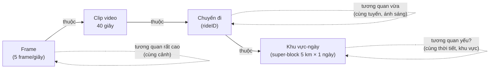
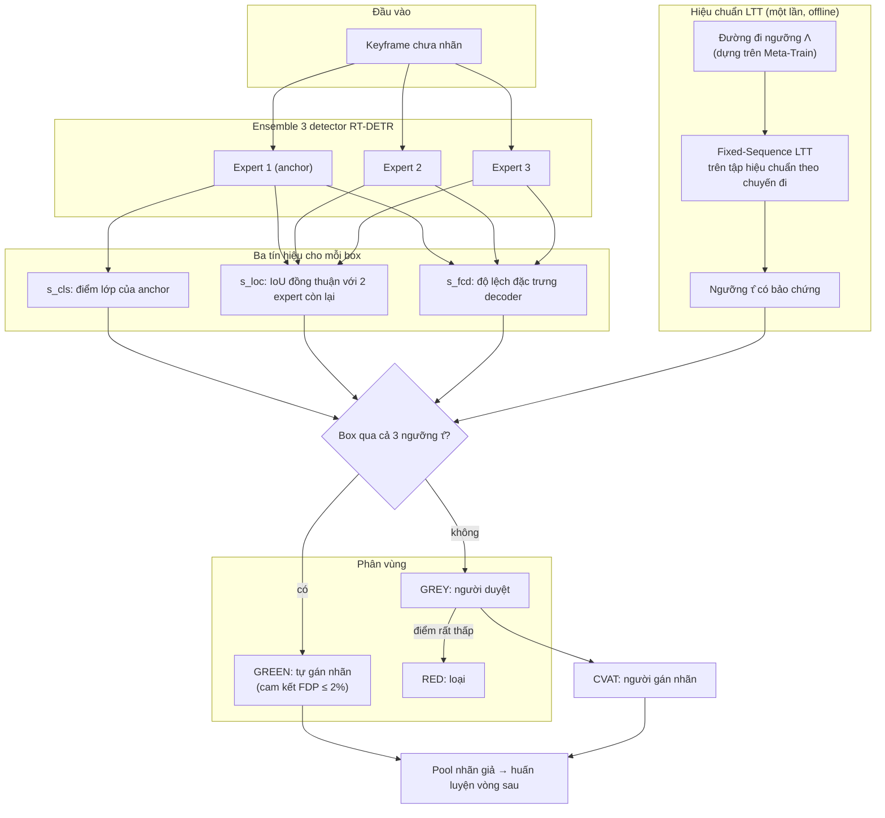
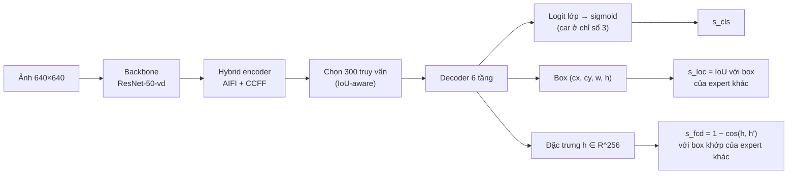
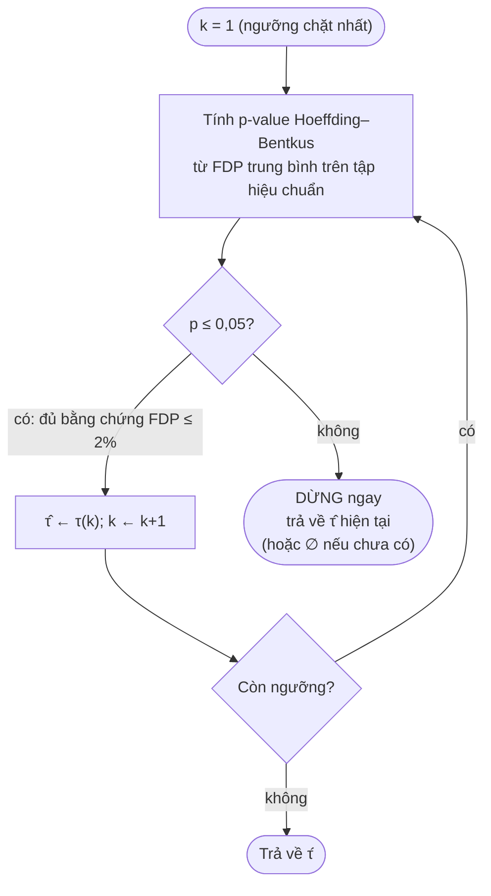
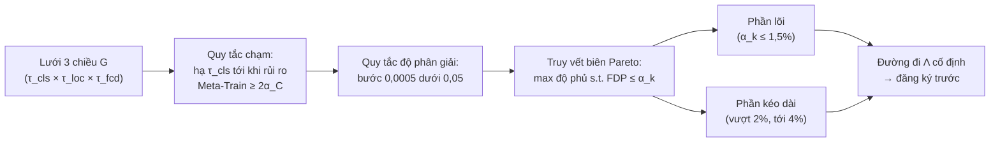
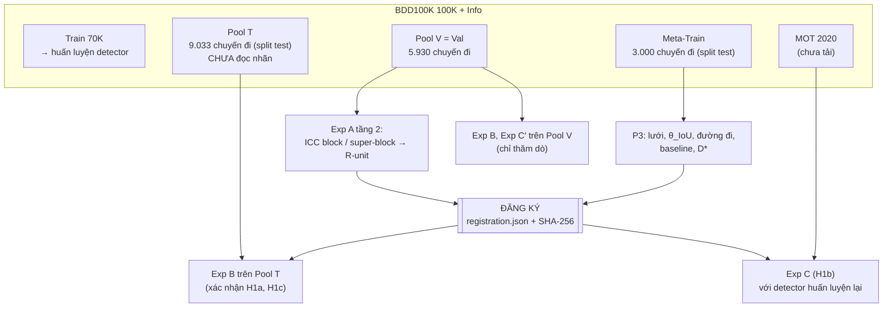
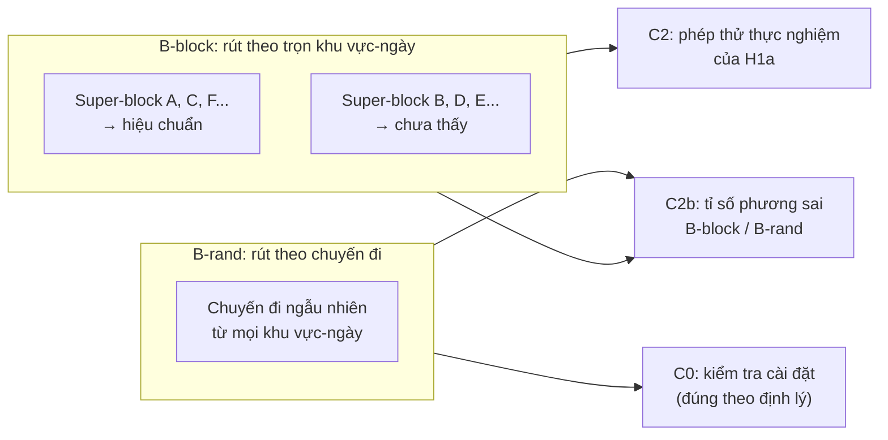
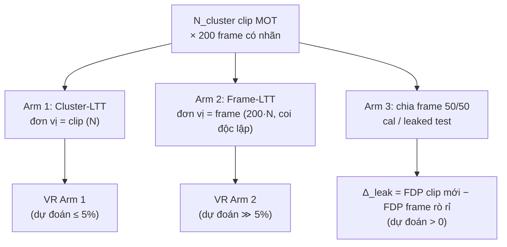
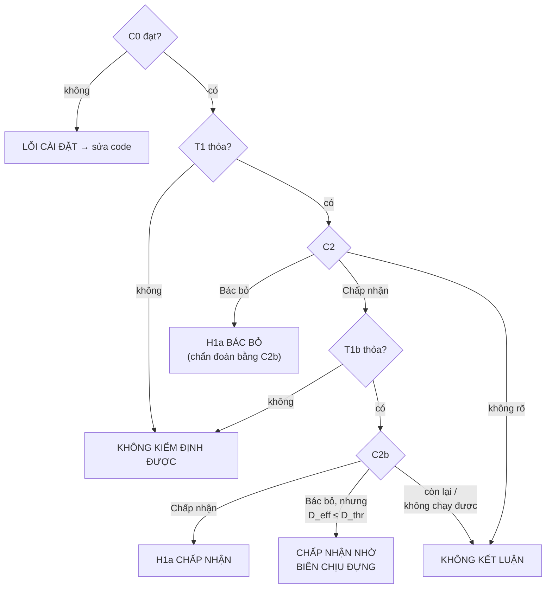

# H1 — Bảo chứng thống kê cho gán nhãn giả trên video lái xe

*Bản trình bày theo cấu trúc bài báo: Vấn đề → Giải pháp → Kiểm chứng. Đặc tả đầy đủ (công thức, chứng minh, quy tắc đăng ký trước) nằm trong `H1_statistical_guarantee_research_v1.4.md`; số liệu nằm trong `H1_real_data_report.md`. Sơ đồ viết bằng Mermaid (hiển thị trên GitHub, VS Code).*

---

## Tóm tắt

Gán nhãn giả cho phát hiện vật thể thường chọn box bằng một ngưỡng confidence cố định. Ngưỡng này không đi kèm cam kết nào về tỉ lệ box sai được đưa vào tập huấn luyện. Chúng tôi dùng Learn-then-Test (LTT) để chọn ngưỡng ba chiều (confidence, độ đồng thuận vị trí của ensemble, độ nhất quán đặc trưng) với cam kết: *tỉ lệ box sai trung bình không quá 2%, với độ tin cậy 95%*. Cam kết này dựa trên giả định dữ liệu hiệu chuẩn độc lập, vốn không hiển nhiên đúng với video lái xe. H1 kiểm chứng ba mệnh đề:
- **(H1a)** cam kết đứng vững khi chọn đúng đơn vị thống kê;
- **(H1b)** cam kết sụp đổ khi coi các frame là độc lập;
- **(H1c)** quy trình vẫn giữ được lượng nhãn giả hữu ích.

Thiết kế dùng 3 nhóm metric: quyết định, điều kiện kiểm định được, và mô tả. Kèm theo là đối chứng dương, đối chứng âm, và một pool xác nhận chưa từng đọc nhãn.

---

## 1. Vấn đề

### 1.1. Gán nhãn giả khuếch đại lỗi của chính mô hình

Trong học bán giám sát và học chủ động, mô hình tự gán nhãn cho dữ liệu chưa có nhãn rồi học lại trên chính các nhãn đó. Nhãn sai được học lại sẽ củng cố lỗi, gọi là **thiên kiến xác nhận** (Arazo et al., 2020). Với phát hiện vật thể, các phương pháp phổ biến như STAC (Sohn et al., 2020b) và Unbiased Teacher (Liu et al., 2021) lọc nhãn giả bằng một ngưỡng confidence cố định, tương tự ngưỡng 0,95 của FixMatch cho phân loại (Sohn et al., 2020a).

### 1.2. Ngưỡng confidence không cho biết tỉ lệ sai

Confidence của mạng sâu thường không được hiệu chỉnh (Guo et al., 2017), và với detector, hiệu chỉnh còn phụ thuộc vị trí và kích thước box (Küppers et al., 2020). Vì vậy "confidence ≥ 0,95" không trả lời được câu hỏi mà người vận hành cần: **trong số box tự gán nhãn, bao nhiêu phần trăm là sai?** Trên detector của chúng tôi, phân bố điểm có hai đỉnh: mỗi ảnh chỉ có 2–3 box với điểm ≥ 0,05 nhưng 11–13 box với điểm ≥ 0,005. Đổi ngưỡng từ 0,5 lên 0,95 gần như không thay đổi gì, và ta không biết nó an toàn đến đâu.

### 1.3. Dữ liệu video phá vỡ giả định độc lập

Các phương pháp có bảo chứng (conformal prediction, risk control) đều giả định dữ liệu hiệu chuẩn có thể hoán đổi hoặc độc lập (Vovk et al., 2005; Angelopoulos & Bates, 2023). Khi giả định này sai, độ phủ của conformal prediction suy giảm theo mức vi phạm (Barber et al., 2023; Oliveira et al., 2024). Dữ liệu lái xe có ba tầng phụ thuộc (Hình 1):

*Hình 1. Các tầng phụ thuộc trong BDD100K.*

Coi các quan sát phụ thuộc là độc lập là **giả lặp** (pseudoreplication; Hurlbert, 1984): cỡ mẫu hiệu dụng nhỏ hơn cỡ mẫu danh nghĩa theo hệ số design effect (Kish, 1965). Chia dữ liệu theo từng frame thay vì theo nhóm còn gây **rò rỉ** giữa tập hiệu chuẩn và tập kiểm thử (Roberts et al., 2017; Kapoor & Narayanan, 2023).

### 1.4. Câu hỏi nghiên cứu

> Áp một phương pháp kiểm soát rủi ro có bảo chứng vào video lái xe, thì cam kết "≤ 2% box sai" còn đúng không, đúng với đơn vị thống kê nào, và sai đến mức nào nếu chọn sai đơn vị?

---

## 2. Giải pháp

### 2.1. Kiến trúc tổng thể

*Hình 2. Kiến trúc pipeline. LTT chỉ bảo chứng cho vùng xanh; ranh giới xám/đỏ là heuristic.*

### 2.2. Kiến trúc detector và trích xuất tín hiệu

*Hình 3. RT-DETR (Zhao et al., 2024), ensemble sâu (Lakshminarayanan et al., 2017). Cả ba expert là RT-DETR R50-vd fine-tune một lớp car với seed khác nhau.*

### 2.3. Learn-then-Test: biến chọn ngưỡng thành kiểm định

LTT (Angelopoulos et al., 2025), kế thừa RCPS (Bates et al., 2021), coi mỗi ngưỡng ứng viên là một giả thuyết "ngưỡng này có tỉ lệ sai vượt 2%". Bác bỏ giả thuyết đó nghĩa là ngưỡng được chứng nhận an toàn.

*Hình 4. Fixed-Sequence LTT. Dừng ngay ở lần thất bại đầu tiên khiến cả quy trình chỉ "đặt cược" một lần, nên không cần hiệu chỉnh đa kiểm định (Maurer et al., 1995; Marcus et al., 1976).*

**Cam kết (định lý LTT):** nếu các đơn vị hiệu chuẩn độc lập cùng phân phối và đường đi được dựng trên dữ liệu khác, thì xác suất ngưỡng được chọn có tỉ lệ sai vượt 2% không quá 5%. p-value dùng bất đẳng thức Hoeffding (1963) và Bentkus (2004).

### 2.4. Chọn đơn vị thống kê

Giải pháp cho Mục 1.3 là **hiệu chuẩn trên đơn vị gần độc lập**, thay vì xây bất đẳng thức mới cho dữ liệu phụ thuộc:

| Đơn vị | Có được trong BDD100K? | Vai trò trong H1 |
|---|---|---|
| Frame | Chỉ trong bộ MOT 2020 | Đơn vị **sai** có chủ đích (H1b) |
| Chuyến đi (`rideID`) | Có: 60.137 chuyến đi, khớp một-một với tiền tố tên video trên 99.999 video | Đơn vị mặc định (H1a) |
| Super-block (5 km × ngày địa phương) | Có, từ GPS và giờ ghi hình | Đơn vị dự phòng nếu chuyến đi còn tương quan; nhóm held-out cho phép thử chính |

Quy tắc chọn đơn vị (**R-unit**) đo tương quan nội cụm (ICC) ở cấp super-block trên một pool chẩn đoán riêng, đổi ra design effect $1 + (\tilde m - 1)\thinspace \text{ICC}$ (Kish, 1965; Eldridge et al., 2006), rồi giữ đơn vị chuyến đi nếu design effect nhỏ hơn biên an toàn.

### 2.5. Dựng đường đi ngưỡng

*Hình 5. Dựng đường đi chỉ trên Meta-Train. Phần kéo dài đặt các ngưỡng thật sự không an toàn lên đường đi, để một quy trình sai có chỗ thất bại.*

### 2.6. Ba giả thuyết

| | Phát biểu | Đóng góp |
|---|---|---|
| **H1a** | Với đơn vị đúng, LTT giữ cam kết FDP ≤ 2% (95%), kể cả ở khu vực-ngày chưa có trong tập hiệu chuẩn | Điều kiện tiên quyết cho H2, H3 |
| **H1b** | Coi frame là độc lập làm cam kết sụp đổ khi design effect theo frame vượt biên chịu đựng của HB | **Đóng góp chính** |
| **H1c** | Quy trình gần như luôn chọn được ngưỡng và giữ ≥ 50% độ phủ của cách chọn ngưỡng không bảo chứng | Tính hữu ích thực tế |

---

## 3. Kiểm chứng

### 3.1. Vai trò dữ liệu và cổng đăng ký trước

*Hình 6. Tách dữ liệu theo vai trò. Pool V đã bị nhìn ở các lần chạy trước nên chỉ dùng để chẩn đoán; kết luận xác nhận chỉ lấy từ Pool T (Nosek et al., 2018; Gelman & Loken, 2014).*

### 3.2. Experiment B: kiểm chứng H1a và H1c

Lặp lại hiệu chuẩn 1.002 lần (334 phân hoạch × 3 tập hiệu chuẩn rời nhau). Ở mỗi lần, LTT chọn $\hat\tau$, và ta xem rủi ro thật của $\hat\tau$ trên toàn pool có vượt 2% không.

*Hình 7. Hai cách rút tập hiệu chuẩn. Khi rút theo chuyến đi từ một pool cố định, việc không vi phạm là định lý (Hoeffding, 1963, Định lý 4), nên B-rand chỉ kiểm tra code. Nội dung thực nghiệm nằm ở B-block: hiệu chuẩn ở một số khu vực-ngày, dùng ở nơi khác (Roberts et al., 2017).*

### 3.3. Experiment C: kiểm chứng H1b

*Hình 8. Ba arm trên cùng dữ liệu, cùng đại lượng rủi ro, mức α_C = 10%, quét N_cluster ∈ {20, 100, 200, 400, 800}. Đối chứng âm Exp C′: cùng giao thức trên cặp keyframe cùng chuyến đi, nơi tương quan gần 0.*

### 3.4. Hệ thống metrics

**(a) Metrics quyết định:** đi vào ma trận Chấp nhận / Bác bỏ / Không kết luận.

| Mã | Metric | Định nghĩa | Chấp nhận | Bác bỏ | Dẫn chứng phương pháp |
|---|---|---|---|---|---|
| C0 | VR B-rand | Tỉ lệ lần $\mathcal{R}_{\text{pool}}(\hat\tau) > 0.02$ khi rút theo chuyến đi | cận trên CI ≤ 6,5% | cận dưới > 5% ⇒ lỗi code | Hoeffding (1963); Serfling (1974) |
| C2 | VR B-block | Như C0, rút theo trọn super-block | cận trên ≤ 6,5% | cận dưới > 5% | Angelopoulos et al. (2025) |
| C2b | Design effect thực nghiệm | Var(rủi ro hiệu chuẩn, B-block) / Var(…, B-rand) tại ngưỡng ở mức α | cận trên ≤ 1,5 | cận dưới > 1,3 | Kish (1965); Field & Welsh (2007) |
| C3 | Yield | Tỉ lệ lần $\hat\tau \ne \emptyset$ | ≥ 85% | < 85% | Angelopoulos et al. (2025) |
| C3b | Độ phủ tương đối $\rho_{\text{cov}}$ | Độ phủ của $\hat\tau$ / độ phủ của plug-in trên cùng lưới (trung vị) | ≥ 0,5 | < 0,5 | Bates et al. (2021): cái giá của bảo chứng |
| C4 | $D_{\text{eff}}^{\text{frame}}$ | $1 + (M-1)\thinspace \text{ICC}_{\text{frame}}$, M = 200 | cận dưới ≥ max(5, $D^{\ast}_C$) | cận trên < 2 | Kish (1965); Donner (1986) |
| C5 | VR Arm 2 so với Arm 1 | Trên các mức N_cluster mà Arm 1 có Yield ≥ 50% | Arm 2 > 5% và Arm 1 ≤ 6,5% ở mọi mức | Arm 2 ≤ 6,5% ở ≥ 2 mức | Hurlbert (1984) |

**(b) Metrics điều kiện kiểm định được:** bảo đảm phép thử có khả năng thất bại.

| Mã | Metric | Ý nghĩa | Dẫn chứng |
|---|---|---|---|
| T1 | Có ngưỡng thật sự không an toàn trên đường đi (rủi ro pool > 2%) | Nếu không có, vi phạm là bất khả và C2 vô nghĩa | Chứng minh Theorem 1 |
| T1b | VR của quy trình plug-in không bảo chứng, cận dưới > 5% | **Đối chứng dương**: phép thử bắt được quy trình sai | Lipsitch et al. (2010) |
| T2, T2b | Như T1, T1b cho Exp C ở mức 10% | — | — |

**(c) Metrics mô tả (báo cáo, không quyết định):**

| Nhóm | Metric | Mục đích | Dẫn chứng |
|---|---|---|---|
| Rủi ro | Trung vị, p95 của $\mathcal{R}_{\text{pool}}(\hat\tau)$; $\Delta_{\text{gap}} = 0.02 - \text{trung vị}$ | Mức bảo thủ của LTT | — |
| Rủi ro | Micro-FDP (gộp mọi box) | Macro-FDP có thể thấp hơn Micro-FDP khi cảnh đông có nhiều box sai | Benjamini & Hochberg (1995) cho khái niệm FDR |
| Rủi ro | Tỉ lệ chuyến đi rỗng; Spearman(số box, FDP) | Cơ chế Macro/Micro lệch nhau | — |
| Loại lỗi | Tỉ lệ FP do ảo giác/sai lớp (IoU < 0,5) và do lệch vị trí (IoU ≥ 0,5) | Rủi ro đến từ đâu | Hoiem et al. (2012); Bolya et al. (2020) |
| Hữu ích | Độ phủ tuyệt đối, số box chấp nhận mỗi chuyến đi | Lượng nhãn giả thực tế | Lin et al. (2014) |
| Detector | AP50, AP75, recall, D-ECE | Chất lượng và hiệu chỉnh của detector | Lin et al. (2014); Küppers et al. (2020) |
| Phụ thuộc | ICC ở cấp ảnh-trong-chuyến, block, super-block; Moran's I giữa super-block kề nhau | Cấu trúc tương quan | Searle et al. (1992); Moran (1950); Cliff & Ord (1981) |
| Phụ thuộc | Biên chịu đựng $D^{\ast}$ | Design effect mà HB còn chịu được | Kish (1965); Lehmann (1999) |
| Năng lực | VR của LTT giả vờ cỡ mẫu ×4…×256 | Phép thử nhạy tới mức nào | Lipsitch et al. (2010) |
| Rò rỉ | Rủi ro của chuyến đi có / không chung khu vực-ngày với tập train; $\Delta_{\text{leak}}$ của Arm 3 | Rò rỉ dư và rò rỉ ngữ cảnh | Kapoor & Narayanan (2023) |
| Bền vững | Rủi ro theo nhóm: đêm, mưa/tuyết, cao tốc | Ứng viên stress-test OOD | Yu et al. (2020) |
| Ablation | Đường đi trên lưới thô | Vì sao cần quy tắc độ phân giải | — |
| Công cụ | Tỉ số phương sai ở cấp ảnh-trong-chuyến so với Kish | Công cụ C2b không báo động giả | Field & Welsh (2007) |

Khoảng tin cậy: bootstrap theo phân hoạch (Efron & Tibshirani, 1993), lấy hợp với Clopper–Pearson (Clopper & Pearson, 1934) để không suy biến về [0, 0] khi không có vi phạm.

### 3.5. Ma trận quyết định

*Hình 9. Quyết định cho H1a. H1b: Chấp nhận khi C4 và C5 cùng Chấp nhận, Bác bỏ khi C5 Bác bỏ. H1c: Đạt khi C3 và C3b cùng đạt.*

### 3.6. Lựa chọn thiết kế và dẫn chứng

| Lựa chọn | Lý do | Dẫn chứng |
|---|---|---|
| LTT thay vì ngưỡng confidence | Có cam kết hữu hạn mẫu, không cần mô hình hiệu chỉnh tốt | Angelopoulos et al. (2025); Bates et al. (2021) |
| p-value Hoeffding–Bentkus | Chặt hơn Hoeffding thuần cho biến bị chặn trong [0, 1] | Hoeffding (1963); Bentkus (2004) |
| Fixed-sequence trên đường đi 1 chiều | Không mất năng lực vì hiệu chỉnh đa kiểm định | Maurer et al. (1995); Westfall & Krishen (2001) |
| Đường đi dựng trên Meta-Train riêng | Giữ đường đi độc lập với tập hiệu chuẩn | Cox (1975) |
| Đơn vị = chuyến đi; held-out theo khu vực-ngày | Tránh giả lặp và rò rỉ | Hurlbert (1984); Roberts et al. (2017) |
| Đo design effect thay vì chỉ ICC | ICC nhỏ vẫn có thể cho design effect lớn khi cụm lớn | Kish (1965); Eldridge et al. (2006) |
| Bootstrap theo phân hoạch | Các vòng trong cùng phân hoạch phụ thuộc nhau | Efron & Tibshirani (1993); Field & Welsh (2007) |
| Đối chứng dương / âm | Phép thử chỉ có giá trị nếu bắt được cái sai biết trước | Lipsitch et al. (2010) |
| Đăng ký trước, pool xác nhận riêng | Tránh điều chỉnh quy tắc theo kết quả | Nosek et al. (2018); Gelman & Loken (2014) |
| Ensemble 3 expert cho tín hiệu | Bất định nhận thức qua bất đồng giữa các mô hình | Lakshminarayanan et al. (2017) |
| IoU 0,75 (COCO chặt) | Box sai bao gồm cả lệch vị trí | Lin et al. (2014) |

---

## 4. Kết quả hiện tại (thăm dò, trên Pool V)

| Metric | expert_1 | expert_2 | expert_3 | Diễn giải |
|---|---|---|---|---|
| C0 (VR, rút theo chuyến đi) | 0 / 1.002 | 0 / 1.002 | 0 / 1.002 | Code đúng |
| T1b (VR plug-in) | 47,5% | 11,8% | 28,7% | Phép thử bắt được quy trình sai |
| LTT giả vờ cỡ mẫu ×16 | 12,0% | 1,0% | 6,5% | Độ nhạy khác nhau theo detector |
| C3 Yield | 100% | 100% | 100% | Luôn chọn được ngưỡng |
| $\rho_{\text{cov}}$ (baseline cũ) | 1,06 | 0,99 | 1,10 | Cần chạy lại với baseline mới |
| Độ phủ tuyệt đối (IoU 0,75) | 0,188 | 0,181 | 0,194 | Detector recall thấp |
| Rủi ro tại $\hat\tau$ (trung vị / p95) | 1,02% / 1,46% | 1,10% / 1,45% | 1,19% / 1,43% | Cách trần 2% khoảng 0,8–1 điểm % |
| Micro-FDP (trung vị) | 1,28% | 1,27% | 1,48% | Vẫn dưới 2% |
| FP do ảo giác/sai lớp | 46% | 54% | 45% | Còn lại là lệch vị trí |
| ICC ảnh cùng chuyến | ≈ 0 | ≈ 0 | ≈ 0 | Đơn vị chuyến đi đủ thô ở cấp trong chuyến |
| Tỉ số phương sai (công cụ C2b) | 1,03 | 1,05 | 1,02 | Không báo động giả |
| $D^{\ast}$ | 4,61 | 4,52 | 4,62 | Biên chịu đựng của HB |
| Exp C′: arm frame / plug-in | 0% / 26–41% | 0% / 31–44% | 0% / 28–44% | Không có tương quan thì không sụp đổ |

**Đã chứng minh:** tính hợp lệ của LTT dưới giả định độc lập (định lý, có trích dẫn); đơn vị chuyến đi bằng `rideID` chính thức; công cụ đo và đối chứng hoạt động trên dữ liệu thật.

**Chưa chứng minh:**
- H1a ở mức xác nhận (C2 trên B-block và C2b trên Pool T, dữ liệu đã đủ).
- H1b (cần MOT 2020 và detector huấn luyện lại).
- Các metric detector (AP, D-ECE) chưa tính.

---

## 5. Giới hạn

- Chỉ một lớp (car), dữ liệu BDD100K năm 2017 ở New York, vùng vịnh San Francisco và Tel Aviv.
- Cam kết áp dụng cho Macro-FDP; Micro-FDP chỉ được báo cáo.
- Tương quan cùng tài xế không đo được.
- 91,7% chuyến đi của Pool T có chung khu vực-ngày với dữ liệu huấn luyện detector; điều này được đo bằng metric rò rỉ.
- Phác thảo chứng minh cho nhánh Bentkus khi lấy mẫu không hoàn lại cần được kiểm lại khi viết paper.

---

## Tài liệu tham khảo

1. Angelopoulos, A. N., & Bates, S. (2023). Conformal prediction: A gentle introduction. *Foundations and Trends in Machine Learning*, 16(4), 494–591.
2. Angelopoulos, A. N., Bates, S., Candès, E. J., Jordan, M. I., & Lei, L. (2025). Learn then test: Calibrating predictive algorithms to achieve risk control. *Annals of Applied Statistics*. arXiv:2110.01052.
3. Arazo, E., Ortego, D., Albert, P., O'Connor, N. E., & McGuinness, K. (2020). Pseudo-labeling and confirmation bias in deep semi-supervised learning. *IJCNN 2020*.
4. Barber, R. F., Candès, E. J., Ramdas, A., & Tibshirani, R. J. (2023). Conformal prediction beyond exchangeability. *Annals of Statistics*, 51(2), 816–845.
5. Bates, S., Angelopoulos, A., Lei, L., Malik, J., & Jordan, M. (2021). Distribution-free, risk-controlling prediction sets. *Journal of the ACM*, 68(6).
6. Benjamini, Y., & Hochberg, Y. (1995). Controlling the false discovery rate. *JRSS-B*, 57(1), 289–300.
7. Bentkus, V. (2004). On Hoeffding's inequalities. *Annals of Probability*, 32(2), 1650–1673.
8. Bolya, D., Foley, S., Hays, J., & Hoffman, J. (2020). TIDE: A general toolbox for identifying object detection errors. *ECCV 2020*.
9. Cliff, A. D., & Ord, J. K. (1981). *Spatial Processes: Models & Applications*. Pion.
10. Clopper, C. J., & Pearson, E. S. (1934). The use of confidence or fiducial limits illustrated in the case of the binomial. *Biometrika*, 26(4), 404–413.
11. Cox, D. R. (1975). A note on data-splitting for the evaluation of significance levels. *Biometrika*, 62(2), 441–444.
12. Donner, A. (1986). A review of inference procedures for the intraclass correlation coefficient in the one-way random effects model. *International Statistical Review*, 54(1), 67–82.
13. Efron, B., & Tibshirani, R. J. (1993). *An Introduction to the Bootstrap*. Chapman & Hall.
14. Eldridge, S. M., Ashby, D., & Kerry, S. (2006). Sample size for cluster randomized trials. *International Journal of Epidemiology*, 35(5), 1292–1300.
15. Field, C. A., & Welsh, A. H. (2007). Bootstrapping clustered data. *JRSS-B*, 69(3), 369–390.
16. Gelman, A., & Loken, E. (2014). The statistical crisis in science. *American Scientist*, 102(6), 460–465.
17. Guo, C., Pleiss, G., Sun, Y., & Weinberger, K. Q. (2017). On calibration of modern neural networks. *ICML 2017*.
18. Hoeffding, W. (1963). Probability inequalities for sums of bounded random variables. *JASA*, 58(301), 13–30.
19. Hoiem, D., Chodpathumwan, Y., & Dai, Q. (2012). Diagnosing error in object detectors. *ECCV 2012*.
20. Hurlbert, S. H. (1984). Pseudoreplication and the design of ecological field experiments. *Ecological Monographs*, 54(2), 187–211.
21. Kapoor, S., & Narayanan, A. (2023). Leakage and the reproducibility crisis in machine-learning-based science. *Patterns*, 4(9).
22. Kish, L. (1965). *Survey Sampling*. Wiley.
23. Küppers, F., Kronenberger, J., Shantia, A., & Haselhoff, A. (2020). Multivariate confidence calibration for object detection. *CVPR Workshops 2020*.
24. Lakshminarayanan, B., Pritzel, A., & Blundell, C. (2017). Simple and scalable predictive uncertainty estimation using deep ensembles. *NeurIPS 2017*.
25. Lehmann, E. L. (1999). *Elements of Large-Sample Theory*. Springer.
26. Lin, T.-Y., et al. (2014). Microsoft COCO: Common objects in context. *ECCV 2014*.
27. Lipsitch, M., Tchetgen Tchetgen, E., & Cohen, T. (2010). Negative controls. *Epidemiology*, 21(3), 383–388.
28. Liu, Y.-C., Ma, C.-Y., He, Z., Kuo, C.-W., Chen, K., Zhang, P., Wu, B., Kira, Z., & Vajda, P. (2021). Unbiased teacher for semi-supervised object detection. *ICLR 2021*.
29. Marcus, R., Peritz, E., & Gabriel, K. R. (1976). On closed testing procedures with special reference to ordered analysis of variance. *Biometrika*, 63(3), 655–660.
30. Maurer, W., Hothorn, L. A., & Lehmacher, W. (1995). Multiple comparisons in drug clinical trials and preclinical assays: a-priori ordered hypotheses. *Biometrie in der chemisch-pharmazeutischen Industrie*, 6, 3–18.
31. Moran, P. A. P. (1950). Notes on continuous stochastic phenomena. *Biometrika*, 37(1/2), 17–23.
32. Nosek, B. A., Ebersole, C. R., DeHaven, A. C., & Mellor, D. T. (2018). The preregistration revolution. *PNAS*, 115(11), 2600–2606.
33. Oliveira, R. I., Orenstein, P., Ramos, T., & Romano, J. V. (2024). Split conformal prediction and non-exchangeable data. *JMLR*, 25.
34. Roberts, D. R., et al. (2017). Cross-validation strategies for data with temporal, spatial, hierarchical, or phylogenetic structure. *Ecography*, 40(8), 913–929.
35. Searle, S. R., Casella, G., & McCulloch, C. E. (1992). *Variance Components*. Wiley.
36. Serfling, R. J. (1974). Probability inequalities for the sum in sampling without replacement. *Annals of Statistics*, 2(1), 39–48.
37. Sohn, K., Berthelot, D., Li, C.-L., Zhang, Z., Carlini, N., Cubuk, E. D., Kurakin, A., Zhang, H., & Raffel, C. (2020a). FixMatch: Simplifying semi-supervised learning with consistency and confidence. *NeurIPS 2020*.
38. Sohn, K., Zhang, Z., Li, C.-L., Zhang, H., Lee, C.-Y., & Pfister, T. (2020b). A simple semi-supervised learning framework for object detection. arXiv:2005.04757.
39. Vovk, V., Gammerman, A., & Shafer, G. (2005). *Algorithmic Learning in a Random World*. Springer.
40. Westfall, P. H., & Krishen, A. (2001). Optimally weighted, fixed sequence and gatekeeping multiple testing procedures. *Journal of Statistical Planning and Inference*, 99(1), 25–40.
41. Yu, F., et al. (2020). BDD100K: A diverse driving dataset for heterogeneous multitask learning. *CVPR 2020*.
42. Zhao, Y., et al. (2024). DETRs beat YOLOs on real-time object detection. *CVPR 2024*.
