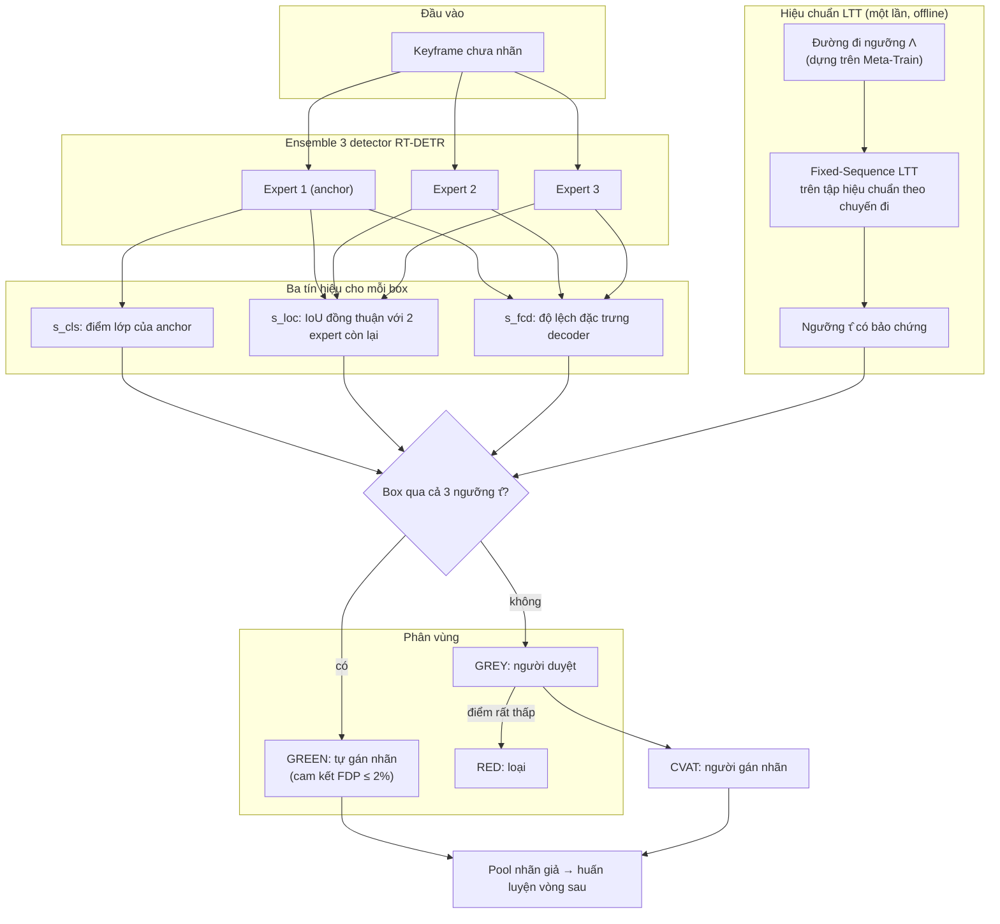
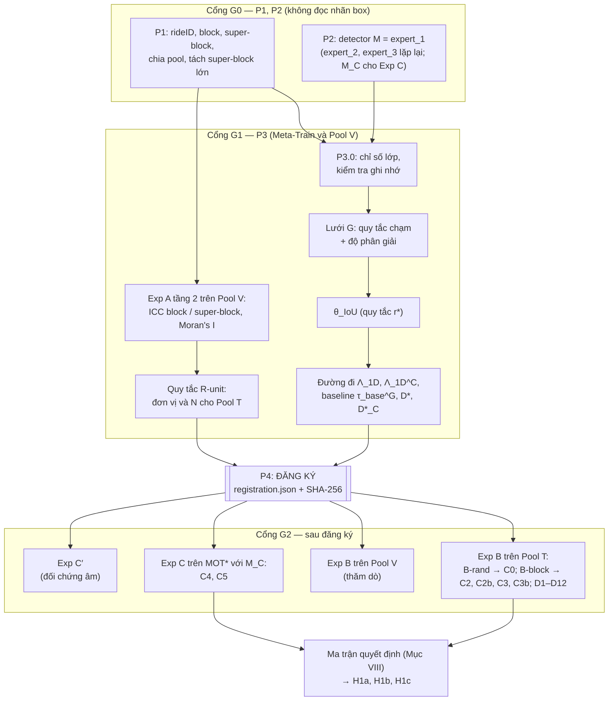
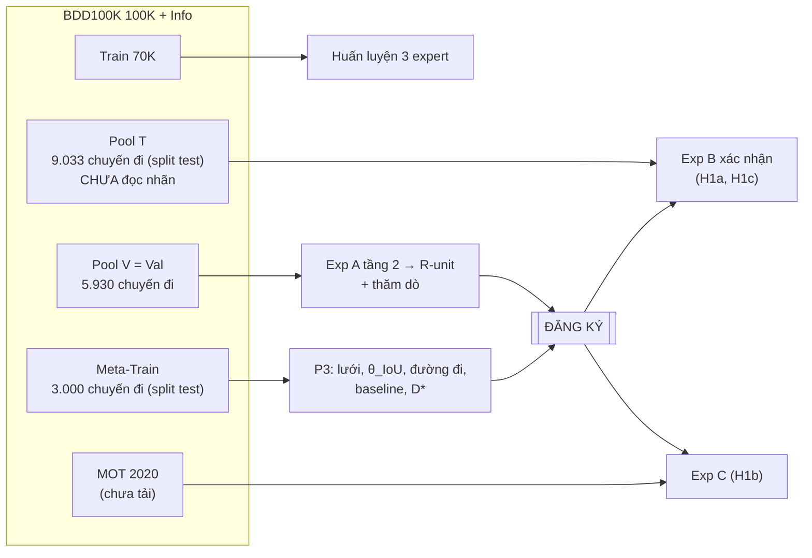
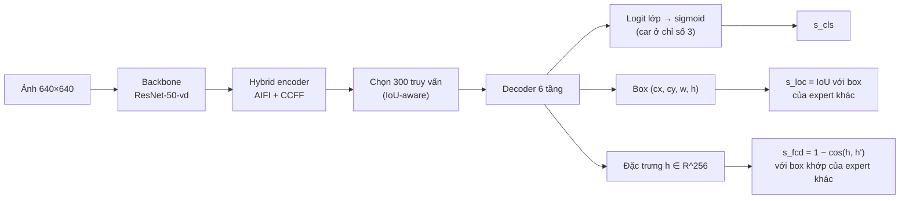
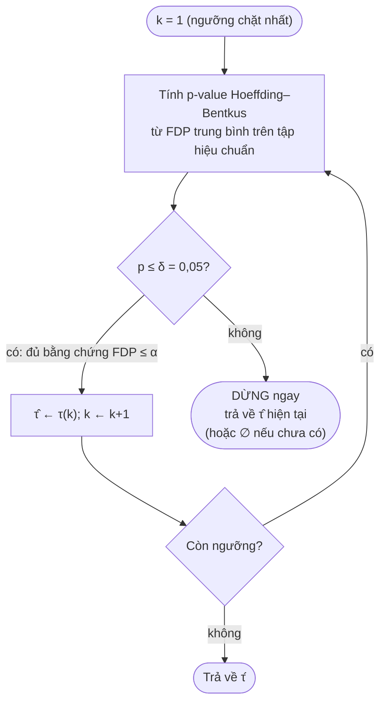
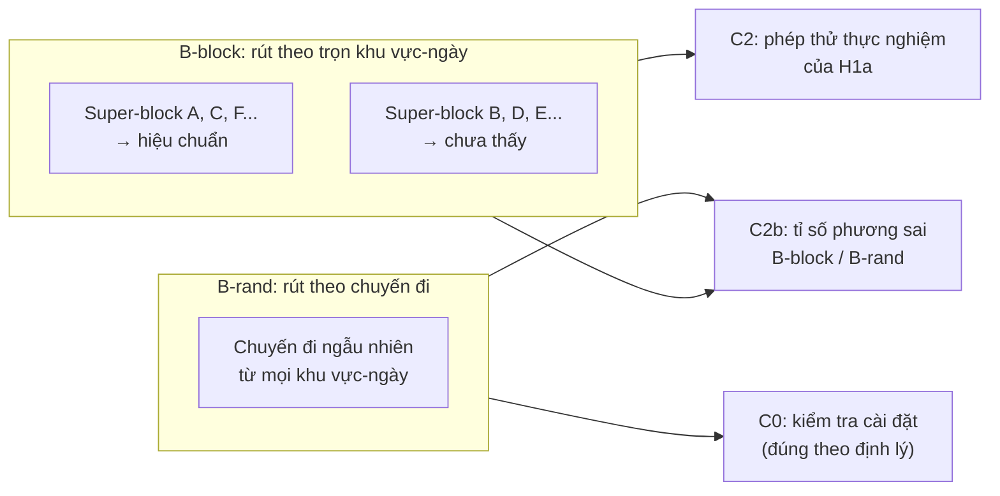
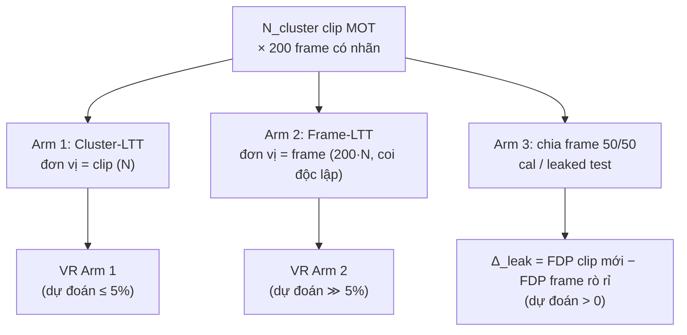
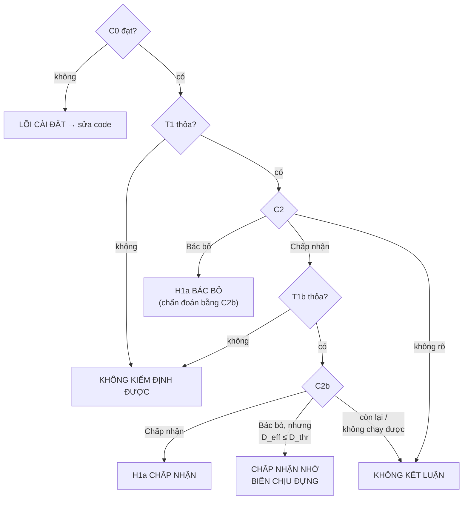

# GIẢ THUYẾT 1 (H1): THE STATISTICAL GUARANTEE HYPOTHESIS
## Thiết kế hoàn chỉnh, kiến trúc, công thức, chứng minh và trạng thái kiểm chứng — Phiên bản 1.4

**Phiên bản 1.4 — 15/10/2026.** Tài liệu gồm ba phần:
* **Phần A (Mục I–VIII):** thiết kế hoàn chỉnh của H1, kế thừa bản 1.2–1.3 và sửa theo kết quả chạy thật. Phần này là **bản đăng ký trước cho lần chạy xác nhận** trên Pool T (Mục III.2), chưa từng đọc nhãn.
* **Phần B (Mục IX):** trạng thái chứng minh: điều gì đã được chứng minh toán học (kèm tài liệu gốc), điều gì đã có bằng chứng thực nghiệm, điều gì chưa.
* **Phần C (Mục X–XII):** giới hạn, tái lập, tài liệu tham khảo.

Kết quả thực nghiệm chi tiết của các lần chạy thăm dò nằm trong `H1_real_data_report.md`; mô phỏng nằm trong `H1_simulation_report.md`.

### Thay đổi từ bản 1.3 sang 1.4

1. **Ride ID chính thức.** File `bdd100k_info` có trường `rideID`. Trên 99.999 video có file info hợp lệ, tiền tố 8 ký tự của tên video trùng 8 ký tự đầu của `rideID` và hai đại lượng ánh xạ một-một (60.137 chuyến đi). Giả định "tiền tố = chuyến đi" của bản 1.3 nay là sự kiện đã kiểm.
2. **Block và super-block dựng được** từ GPS và `startTime` (Mục VII.P1). Các quy tắc phụ thuộc super-block (C2b, Moran's $I$, D8, B-block) nay chạy được.
3. **Ba vai trò dữ liệu tách bạch** (Mục III.2): Meta-Train $\mathcal{M}$ (dựng đường đi), Pool V (BDD Val, chẩn đoán và thăm dò, đã đọc nhãn), Pool T (9.033 chuyến đi của split test ngoài Meta-Train, **chưa đọc nhãn**, dùng cho kiểm định xác nhận).
4. **Diễn giải lại Exp B (sửa lỗi khái niệm của bản 1.2–1.3).** Khi tập hiệu chuẩn được rút ngẫu nhiên theo đơn vị từ một pool cố định, việc $\mathbb{P}(\mathcal{R}_ {\text{pool}}(\hat\tau) > \alpha) \le \delta$ là **định lý** (Mệnh đề 4; nhánh Bentkus còn cần kiểm chi tiết, xem O4), không phải giả thuyết thực nghiệm. Nhánh B-rand vì vậy chỉ là **kiểm tra cài đặt** (C0). Nội dung thực nghiệm của H1a nằm ở nhánh **B-block** (hiệu chuẩn theo trọn super-block) và ở C2b. Kết quả C2 trên Val của bản 1.3 (khi chưa có super-block, B-block trùng B-rand) vì vậy là kiểm tra cài đặt đã đạt, chưa phải bằng chứng cho H1a.
5. **Baseline của C3b** đổi thành plug-in trên **cùng lưới $G$** ($\tau_ {\text{base}}^{G}$, Mục VI.6). Baseline cũ chỉ lọc confidence trên lưới thô, nên LTT có thể có độ phủ cao hơn baseline ($\rho_ {\text{cov}} > 1$) và C3b đạt một cách tầm thường.
6. **Exp C cần detector riêng $\mathcal{M}_ C$** huấn luyện trên 100K train trừ các chuyến đi của clip MOT dùng trong Exp C (A2). Các expert hiện có đã học trên toàn bộ 100K train.
7. **D8 chạy được:** 91,7% chuyến đi của Pool T có chung super-block với ít nhất một chuyến đi trong tập huấn luyện detector; D8 so rủi ro của nhóm này với nhóm còn lại.

---

# BẢNG TRA CỨU

## Bảng ký hiệu toán học

| Ký hiệu | Đọc là | Ý nghĩa trong H1 |
|---|---|---|
| $\alpha = 0.02$ | alpha | Mức trần rủi ro cam kết cho H1a, H1c: tỉ lệ box sai trung bình không quá 2% |
| $\alpha_ C = 0.10$ | alpha C | Mức trần rủi ro dùng trong Exp C (H1b) |
| $\delta = 0.05$ | delta | Xác suất cho phép cam kết bị sai; độ tin cậy là $1 - \delta$ = 95% |
| $\beta = 0.15$ | beta | Xác suất cho phép quy trình trả về rỗng (H1c yêu cầu Yield ≥ 85%) |
| $v$, $x_ v$, $\mathcal{Y}_ v$ | | Một video; keyframe của nó; tập nhãn box của keyframe |
| $r$, $U_ r$, $m_ r$ | | Một chuyến đi (`rideID`); tập video của chuyến đi; số video trong chuyến |
| $U$, $U_ i$ | | Đơn vị thống kê (chuyến đi, hoặc super-block nếu R-unit yêu cầu) |
| $\mathcal{P}$ | | Phân phối (quần thể) của đơn vị thống kê |
| $\Pi$, $n$ | pi | Một pool đánh giá hữu hạn và số đơn vị của nó |
| $\mathcal{D}_ {\text{cal}}$, $N$ | | Tập hiệu chuẩn và số đơn vị của nó (mặc định $N = 1.500$) |
| $\mathcal{M}$ | | Detector đang kiểm định (expert_1); $\mathcal{M}_ C$ là detector huấn luyện lại cho Exp C |
| $q$ | | Một truy vấn (box dự đoán) của RT-DETR; mỗi ảnh có 300 truy vấn |
| $b_ q$, $h_ q$ | | Tọa độ box và vectơ đặc trưng decoder (256 chiều) của truy vấn $q$ |
| $s_ {\text{cls}}, s_ {\text{loc}}, s_ {\text{fcd}}$ | | Ba tín hiệu của một box: điểm lớp, độ đồng thuận vị trí giữa các expert, độ lệch đặc trưng |
| $\tau = (\tau_ {\text{cls}}, \tau_ {\text{loc}}, \tau_ {\text{fcd}})$ | tau | Bộ ba ngưỡng lọc box |
| $\mathcal{A}_ v(\tau)$ | | Tập box của ảnh $v$ được chấp nhận ở ngưỡng $\tau$ |
| $G$ | | Lưới hữu hạn các bộ ngưỡng ứng viên |
| $\Lambda_ {1D} = (\tau^{(1)}, \dots, \tau^{(K)})$ | lambda | Đường đi ngưỡng một chiều, từ chặt đến lỏng; $\Lambda_ {1D}^{C}$ là đường đi cho Exp C |
| $K$ | | Số điểm trên đường đi |
| $\hat\tau$ | tau mũ | Ngưỡng do LTT chọn; $\hat\tau = \emptyset$ nghĩa là không chọn được ngưỡng nào |
| $\theta_ {\text{IoU}}$ | theta | Ngưỡng IoU để một box được tính là đúng (0,75 hoặc 0,5) |
| $\text{TP}_ v$, $V_ v$ | | Số box đúng (true positive) và số box sai (false positive) trong ảnh $v$ |
| $N_ r^{\text{acc}}$ | | Tổng số box được chấp nhận trong chuyến đi $r$ |
| $\text{FDP}_ r$, $Z_ r$ | | Tỉ lệ box sai trong chuyến đi $r$ (thống kê của đơn vị) |
| $\mathcal{R}(\tau)$ | R | Rủi ro thật: FDP kỳ vọng trên quần thể |
| $\widehat{\mathcal{R}}_ N(\tau)$ | R mũ | Rủi ro thực nghiệm: FDP trung bình trên $N$ đơn vị hiệu chuẩn |
| $\mathcal{R}_ {\Pi}(\tau)$ | | Rủi ro trên toàn pool $\Pi$ (dùng làm "rủi ro thật" trong Exp B) |
| $M_ r$ | | Số đối tượng có nhãn (GT) thuộc lớp đánh giá trong chuyến đi $r$ |
| $\operatorname{Cov}(\tau; S)$ | độ phủ | Tỉ lệ đối tượng GT được phủ bởi box đúng trên tập $S$ |
| $\rho_ {\text{cov}}$ | rho | Độ phủ của $\hat\tau$ chia cho độ phủ của baseline (C3b) |
| $p_ {\text{HB}}$ | | p-value Hoeffding–Bentkus |
| $d_ {\text{KL}}(a, b)$ | | Phân kỳ Kullback–Leibler giữa hai phân phối Bernoulli |
| $k_ {\max}(N)$ | | Số box sai tối đa (quy đổi) để HB vẫn chứng nhận được ở cỡ mẫu $N$ |
| $\text{UCB}_ \delta$ | | Cận trên tin cậy $1 - \delta$ của rủi ro |
| $H_ 0(\tau)$ | | Giả thuyết không: "ngưỡng $\tau$ có rủi ro vượt $\alpha$" |
| $\mathcal{H}_ 0$, $j^{\ast }$ | | Tập các điểm trên đường đi có rủi ro thật vượt $\alpha$; điểm đầu tiên trong đó |
| $\text{ICC}$ | | Hệ số tương quan nội cụm |
| $\tilde m$ | m ngã | Kích thước cụm hiệu dụng: số đơn vị trung bình của cụm chứa một đơn vị ngẫu nhiên |
| $D_ {\text{eff}}$ | | Design effect: hệ số phóng đại phương sai do tương quan trong cụm |
| $\hat D_ {\text{eff}}^{\text{emp}}$ | | Design effect thực nghiệm, đo bằng tỉ số phương sai B-block / B-rand (C2b) |
| $D^{\ast }$, $D^{\ast }_ C$ | | Biên chịu đựng: design effect lớn nhất mà HB còn giữ cam kết (xấp xỉ) |
| $D_ {\text{thr}} = \min(2, \hat D^{\ast })$ | | Ngưỡng an toàn dùng trong quy tắc R-unit |
| $\sigma_ \alpha^2$ | sigma bình phương | Phương sai của FDP tại điểm đầu tiên vượt $\alpha$ trên đường đi |
| $z_ {1-\delta}$ | | Phân vị chuẩn mức $1 - \delta$ (bằng 1,645) |
| $r^{\ast }(\tau)$ | r sao | Mức rủi ro tối đa để một ngưỡng qua được kiểm định ở khoảng 95% số lần |
| $P$, $K$, $B$ | | Số phân hoạch, số tập hiệu chuẩn mỗi phân hoạch, tổng số vòng ($B = P \cdot K$) |
| $e_ b$ | | Biến chỉ thị vòng $b$ có vi phạm ($\mathcal{R}_ {\Pi}(\hat\tau_ b) > \alpha$) |
| $\text{VR}$ | | Violation rate: tỉ lệ vòng vi phạm, $\frac{1}{B}\sum_ b e_ b$ |
| $M = 200$ | | Số frame có nhãn mỗi clip MOT trong Exp C |
| $Z_ c$, $\text{FDP}_ {c,t}$ | | FDP trung bình của clip $c$; FDP của frame $t$ trong clip $c$ |
| $N_ {\text{cluster}}$, $N_ {\text{nom}}$ | | Số clip hiệu chuẩn; số frame danh nghĩa ($200 \cdot N_ {\text{cluster}}$) |
| $\Delta_ {\text{leak}}$ | delta leak | Chênh lệch FDP giữa clip mới và frame rò rỉ (Arm 3) |
| $\Delta_ {\text{gap}}$ | | Khoảng cách giữa $\alpha$ và rủi ro trung vị tại $\hat\tau$ (mức bảo thủ) |
| $\mathbb{P}$, $\mathbb{E}$, $\operatorname{Var}$ | | Xác suất, kỳ vọng, phương sai |
| $\mathbb{1}[\cdot]$ | | Hàm chỉ thị: bằng 1 nếu điều kiện đúng, 0 nếu sai |
| $\lvert S \rvert$ | | Số phần tử của tập $S$ |
| $\lceil x \rceil$, $\lfloor x \rfloor$ | | Làm tròn lên, làm tròn xuống |
| $\blacksquare$ | | Kết thúc chứng minh |

## Bảng thuật ngữ

| Thuật ngữ | Giải thích |
|---|---|
| **Gán nhãn giả (pseudo-labeling)** | Mô hình tự gán nhãn cho dữ liệu chưa có nhãn, rồi dùng chính các nhãn đó để huấn luyện vòng sau |
| **Thiên kiến xác nhận (confirmation bias)** | Mô hình học lại lỗi của chính nó qua nhãn giả sai, khiến lỗi tích lũy |
| **FP (false positive)** | Box dự đoán không khớp với đối tượng thật nào cùng lớp ở IoU $\ge \theta_ {\text{IoU}}$ |
| **IoU** | Tỉ lệ diện tích giao trên diện tích hợp của hai box; đo mức trùng khớp vị trí |
| **FDP (false discovery proportion)** | Tỉ lệ box sai trong số box được chấp nhận |
| **Macro-FDP / Micro-FDP** | Macro: tính FDP từng chuyến đi rồi lấy trung bình (đại lượng được cam kết). Micro: gộp mọi box rồi tính một tỉ lệ (chỉ báo cáo) |
| **Độ phủ (coverage)** | Tỉ lệ đối tượng thật được bắt bởi box đúng đã chấp nhận |
| **LTT (Learn-then-Test)** | Phương pháp chọn ngưỡng bằng kiểm định thống kê, cho cam kết hữu hạn mẫu về rủi ro (Angelopoulos et al., 2025) |
| **Fixed-sequence testing** | Kiểm định lần lượt theo thứ tự cố định, dừng ở lần thất bại đầu tiên |
| **p-value** | Xác suất thấy dữ liệu "tốt" như quan sát nếu ngưỡng thật ra không an toàn; nhỏ hơn $\delta$ thì ngưỡng được chứng nhận |
| **Hoeffding–Bentkus (HB)** | Bất đẳng thức tập trung dùng để tính p-value cho biến bị chặn trong [0, 1] |
| **Bảo chứng PAC / hữu hạn mẫu** | Cam kết dạng "với xác suất ít nhất 95%, rủi ro không vượt 2%", đúng với mọi cỡ mẫu, không cần xấp xỉ tiệm cận |
| **Null đúng** | Một ngưỡng trên đường đi thực sự có rủi ro vượt $\alpha$; phép thử chỉ có ý nghĩa khi đường đi có null đúng |
| **Đường đi kéo dài** | Phần đường đi đi qua mức trần $\alpha$, để đặt null đúng lên đường đi |
| **Truy vết biên Pareto** | Với mỗi mức rủi ro, chọn ngưỡng cho độ phủ cao nhất; nối lại thành đường đi |
| **Quy tắc chạm** | Hạ ngưỡng confidence thấp nhất của lưới tới khi lưới chứa ngưỡng có rủi ro đủ cao |
| **Quy tắc độ phân giải** | Lưới ngưỡng confidence đủ mịn (bước 0,0005) để rủi ro không nhảy quanh $\alpha$ |
| **Baseline plug-in** | Cách chọn ngưỡng thông thường không có bảo chứng: lấy ngưỡng lỏng nhất mà FDP ước lượng $\le \alpha$ |
| **Yield** | Tỉ lệ lần LTT chọn được ngưỡng (không rỗng) |
| **VR (violation rate)** | Tỉ lệ lần ngưỡng được chọn có rủi ro thật vượt $\alpha$; LTT hợp lệ thì VR $\le \delta$ |
| **Chuyến đi (ride)** | Một phiên ghi hình của một xe, xác định bằng `rideID`; trung bình 1,66 clip mỗi chuyến |
| **Block / super-block** | Nhóm chuyến đi theo ô 1 km × khung 2 giờ / ô 5 km × ngày (giờ địa phương) |
| **Pool** | Tập đơn vị dùng để đánh giá, coi như quần thể trong Exp B |
| **Meta-Train** | Tập dữ liệu riêng chỉ dùng để dựng lưới, đường đi và các tham số trước khi đăng ký |
| **Pool V / Pool T** | Pool chẩn đoán và thăm dò (Val, đã xem nhãn) / Pool xác nhận (chưa từng đọc nhãn) |
| **B-rand / B-block** | Rút tập hiệu chuẩn theo từng chuyến đi / theo trọn super-block |
| **Đăng ký trước (pre-registration)** | Chốt toàn bộ quy tắc và tham số (kèm mã băm) trước khi đọc dữ liệu đánh giá |
| **Con đường rẽ nhánh (forking paths)** | Điều chỉnh quy tắc sau khi đã thấy dữ liệu, làm kết luận kém tin cậy |
| **Giả lặp (pseudoreplication)** | Coi các quan sát phụ thuộc nhau là độc lập, làm phóng đại cỡ mẫu |
| **Rò rỉ (leakage)** | Thông tin của tập kiểm thử lọt vào quá trình huấn luyện hoặc hiệu chuẩn |
| **ICC (tương quan nội cụm)** | Mức giống nhau giữa các đơn vị cùng cụm, từ 0 (độc lập) đến 1 (giống hệt) |
| **Design effect** | Hệ số cho biết phương sai lớn hơn bao nhiêu lần so với khi các đơn vị độc lập |
| **Biên chịu đựng $D^{\ast }$** | Design effect lớn nhất mà HB còn giữ được cam kết, nhờ HB vốn bảo thủ |
| **Quy tắc R-unit** | Quy tắc chọn đơn vị thống kê (chuyến đi, block hay super-block) dựa trên design effect đo được |
| **Moran's I** | Chỉ số tự tương quan không gian giữa các vị trí lân cận |
| **Đối chứng dương / âm** | Chạy phép thử trên trường hợp biết trước là sai / đúng để chứng minh phép thử có năng lực / không báo động giả |
| **T1, T1b, T2, T2b** | Điều kiện kiểm định được: có null đúng (T1, T2); phép thử bắt được quy trình không bảo chứng (T1b, T2b) |
| **C0, C2, C2b, C3, C3b, C4, C5** | Các tiêu chí quyết định (Mục VIII) |
| **D1–D12** | Các chỉ số mô tả, không dùng để quyết định (Mục VII) |
| **Ablation** | Bỏ một thành phần của thiết kế để xem nó cần thiết đến đâu |
| **Bootstrap theo phân hoạch** | Ước lượng khoảng tin cậy bằng cách lấy mẫu lại các phân hoạch |
| **Clopper–Pearson** | Khoảng tin cậy chính xác cho tỉ lệ nhị thức |
| **RT-DETR** | Detector dạng transformer thời gian thực (Zhao et al., 2024) |
| **Ensemble / expert** | Nhóm nhiều mô hình huấn luyện độc lập; mỗi mô hình là một expert |
| **Keyframe** | Ảnh tại giây thứ 10 của mỗi video BDD100K, ảnh có nhãn của bộ 100K |
| **OOD (out-of-distribution)** | Dữ liệu khác phân phối huấn luyện (thời tiết cực đoan, thành phố mới) |

---

# PHẦN A — THIẾT KẾ

## I. PHÁT BIỂU GIẢ THUYẾT

### 1.1. Bối cảnh

Trong gán nhãn giả có chọn lọc cho phát hiện vật thể trên xe tự hành, box sai được đưa vào tập huấn luyện gây thiên kiến xác nhận tích lũy. H1 thay ngưỡng cảm tính (ví dụ confidence $> 0.95$) bằng ngưỡng có **bảo chứng hữu hạn mẫu** chọn bởi Learn-then-Test (LTT; Angelopoulos et al., 2025), và kiểm chứng bảo chứng đó trên dữ liệu video lái xe, nơi giả định i.i.d. của LTT không hiển nhiên đúng.

### 1.2. Ba mệnh đề

> **H1a (bảo chứng PAC).** Với đơn vị thống kê $U$ do quy tắc R-unit chọn (chuyến đi, hoặc super-block), quy trình Fixed-Sequence LTT trên đường đi $\Lambda_ {1D}$ cố định tiên nghiệm chọn ra $\hat\tau$ thỏa
>
> $$
> \mathbb{P}_ {\mathcal{D}_ {\text{cal}} \sim \mathcal{P}^N}\big(\mathcal{R}(\hat\tau) \le \alpha\big) \ge 1 - \delta, \qquad \alpha = 0.02,\enspace \delta = 0.05,
> $$
>
> và bảo chứng này **đứng vững khi ngưỡng được dùng trên các khu vực-ngày (super-block) không có trong tập hiệu chuẩn**.
> *Kiểm chứng:* C0 (cài đặt), C2 trên nhánh B-block và C2b (tiền đề A1 ở cấp super-block), Mục VIII.

> **H1b (sụp đổ khi chia theo frame).** Coi các frame của cùng một video là độc lập làm cỡ mẫu hiệu dụng sụp đổ ($N_ {\text{eff}} \ll N_ {\text{nominal}}$) và gây rò rỉ ngữ cảnh, khiến LTT tính theo số frame danh nghĩa vi phạm bảo chứng với xác suất vượt rõ $\delta$ trên video mới. Cơ chế này được dự đoán xảy ra khi design effect theo frame vượt biên chịu đựng của HB: $D_ {\text{eff}}^{\text{frame}} > D^{\ast}_ C$ (Mục 5.10).
> *Kiểm chứng:* C4, C5 ở mức $\alpha_ C = 0.10$ trên bộ MOT 2020.

> **H1c (không tầm thường).** Với detector $\mathcal{M}$ và $\Lambda_ {1D}$ đã chọn:
>
> $$
> \mathbb{P}(\hat\tau \ne \emptyset) \ge 1 - \beta,\enspace \beta = 0.15, \qquad \operatorname{Median}_ b\thinspace  \rho_ {\text{cov}}(\hat\tau_ b) \ge \gamma_ {\text{cov}} = 0.5,
> $$
>
> với $\rho_ {\text{cov}}$ là độ phủ của $\hat\tau$ chia cho độ phủ của baseline plug-in trên cùng lưới (Mục VI.6).
> *Kiểm chứng:* C3, C3b. Thất bại của H1c không bác bỏ H1a.

### 1.3. Định vị đóng góp

LTT hợp lệ dưới i.i.d. là kết quả đã chứng minh (Bates et al., 2021; Angelopoulos et al., 2025). H1a là điều kiện tiên quyết cho H2 và H3, không phải đóng góp mới. Đóng góp của H1 nằm ở:
1. **H1b:** định lượng mức sụp đổ của bảo chứng khi bỏ qua tương quan theo thời gian của video, trên cùng detector và cùng dữ liệu.
2. **Giao thức chọn đơn vị thống kê** cho dữ liệu video lái xe (R-unit, B-block, C2b) và phép thử đầu-cuối của nó.
3. **Biên chịu đựng tương quan của HB** ($D^{\ast}$) đo trên dữ liệu thật.
4. **Phương pháp kiểm chứng một tuyên bố kiểm soát rủi ro:** đường đi kéo dài qua mức trần, quy tắc chạm và độ phân giải của lưới, điều kiện năng lực bằng đối chứng dương (T1b, T2b), và việc tách kiểm tra cài đặt (C0) khỏi kiểm định thực nghiệm (C2 trên B-block).

Về các công trình suy diễn phi tham số trên dữ liệu không trao đổi được (Barber et al., 2023; Oliveira et al., 2024): H1 không đề xuất bất đẳng thức mới cho dữ liệu phụ thuộc, mà chọn lại đơn vị thống kê để phục hồi i.i.d. và kiểm chứng lựa chọn đó.

---

## II. KÝ HIỆU VÀ ĐỊNH NGHĨA

### 2.1. Dữ liệu

| Ký hiệu | Ý nghĩa |
|---|---|
| $v$ | một video BDD100K (clip 40 giây); $x_ v$ là keyframe tại giây 10, $\mathcal{Y}_ v = \lbrace (b_ k^{\text{gt}}, c_ k)\rbrace$ là nhãn box của keyframe |
| $r(v)$ | chuyến đi của $v$ (`rideID`) |
| $U_ r = \lbrace v : r(v) = r\rbrace$ | đơn vị chuyến đi; $m_ r = \lvert U_ r \rvert$ |
| $\text{blk}(r), \text{sb}(r)$ | block và super-block của chuyến đi $r$ (Mục VII.P1) |
| $\mathcal{C}_ {\text{eval}}$ | tập lớp đánh giá; với các expert hiện có $\mathcal{C}_ {\text{eval}} = \lbrace \text{car}\rbrace$ |
| $\Pi$ | một pool đánh giá (tập hữu hạn đơn vị); $n = \lvert \Pi \rvert$ |
| $\mathcal{D}_ {\text{cal}}$ | tập hiệu chuẩn, $N$ đơn vị |

### 2.2. Detector, ensemble và tín hiệu

Mỗi expert $e \in \lbrace 1, 2, 3\rbrace$ là một RT-DETR (Mục III.3). Với keyframe $x_ v$, expert $e$ trả về 300 truy vấn $q$, mỗi truy vấn có box $b_ q^{e}$, điểm lớp car $s_ q^{e} = \sigma(\ell_ {q,\ell^{\ast}}^{e})$ (sigmoid của logit tại chỉ số lớp $\ell^{\ast}$, Mục VI.7) và đặc trưng decoder $h_ q^{e} \in \mathbb{R}^{256}$. Detector đang kiểm định $\mathcal{M}$ là expert anchor $a$; tập còn lại là $E' = \lbrace 1,2,3\rbrace  \setminus \lbrace a\rbrace$.

Với mỗi truy vấn $q$ của anchor có $s_ q^{a} \ge 0.004$:

$$
s_ {\text{cls}}(q) = s_ q^{a}, \qquad s_ {\text{loc}}(q) = \frac{1}{\lvert E' \rvert}\sum_ {e \in E'} \max_ {q' : s_ {q'}^{e} \ge 0.1} \operatorname{IoU}(b_ q^{a}, b_ {q'}^{e}),
$$

$$
s_ {\text{fcd}}(q) = \frac{1}{\lvert E' \rvert}\sum_ {e \in E'} d_ e(q), \qquad d_ e(q) = 1 - \cos\big(h_ q^{a}, h_ {q^\star_ e}^{e}\big)
$$

với $q^\star_ e$ là truy vấn của expert $e$ đạt IoU lớn nhất với box $q$; nếu không có truy vấn nào của expert $e$ chồng lên $q$ (IoU lớn nhất bằng 0, quy ước $\max \emptyset = 0$) thì đặt $d_ e(q) = 1$.

**Tập chấp nhận** tại $\tau = (\tau_ {\text{cls}}, \tau_ {\text{loc}}, \tau_ {\text{fcd}})$:

$$
\mathcal{A}_ v(\tau) = \lbrace q : s_ {\text{cls}}(q) \ge \tau_ {\text{cls}},\enspace s_ {\text{loc}}(q) \ge \tau_ {\text{loc}},\enspace s_ {\text{fcd}}(q) \le \tau_ {\text{fcd}}\rbrace .
$$

$s_ {\text{fcd}}$ ở đây là định nghĩa vận hành cho H1; H2 có thể thay bằng tín hiệu riêng. Tính hợp lệ của H1 không phụ thuộc chất lượng tín hiệu (Theorem 1 chỉ cần A5).

### 2.3. Ghép cặp và FP

Quy tắc ghép tham lam (giữ nguyên bản 1.2): sắp các box chấp nhận theo $s_ {\text{cls}}$ giảm dần; mỗi box ghép với nhãn chưa dùng cùng lớp có IoU lớn nhất và $\ge \theta_ {\text{IoU}}$; hòa thì chọn nhãn đứng trước trong file. Gọi $\text{TP}_ v(\tau)$ là số box được ghép,

$$
V_ v(\tau) = \lvert \mathcal{A}_ v(\tau) \rvert - \text{TP}_ v(\tau), \qquad V_ v^{\text{halluc}}(\tau) = \lvert\lbrace q \in \mathcal{A}_ v(\tau) \text{ không ghép}: \max_ k \operatorname{IoU}(b_ q, b_ k^{\text{gt}}) < 0.5\rbrace\rvert .
$$

*Tính chất tiền tố.* Vì $\mathcal{A}_ v(\tau)$ đơn điệu theo $\tau_ {\text{cls}}$ và việc ghép một box chỉ phụ thuộc các box có điểm cao hơn, kết quả ghép tại mọi $\tau_ {\text{cls}}$ là tiền tố của một lần ghép duy nhất cho mỗi cặp $(\tau_ {\text{loc}}, \tau_ {\text{fcd}})$.

### 2.4. Thống kê đơn vị và rủi ro

$$
N_ r^{\text{acc}}(\tau) = \sum_ {v \in U_ r} \lvert \mathcal{A}_ v(\tau) \rvert, \quad V_ r(\tau) = \sum_ {v \in U_ r} V_ v(\tau), \quad Z_ r(\tau) = \text{FDP}_ r(\tau) = \frac{V_ r(\tau)}{\max(N_ r^{\text{acc}}(\tau), 1)} \in [0, 1].
$$

$$
\mathcal{R}(\tau) = \mathbb{E}_ {U \sim \mathcal{P}}[Z_ U(\tau)], \qquad \widehat{\mathcal{R}}_ N(\tau) = \frac{1}{N}\sum_ {i=1}^{N} Z_ i(\tau), \qquad \mathcal{R}_ {\Pi}(\tau) = \frac{1}{\lvert \Pi \rvert}\sum_ {r \in \Pi} Z_ r(\tau).
$$

**Micro-FDP** (mô tả): $\text{FDP}_ {\text{pool}}(\tau; S) = \sum_ {r \in S} V_ r / \max(\sum_ {r \in S} N_ r^{\text{acc}}, 1)$.

**Độ phủ:** $\operatorname{Cov}(\tau; S) = \sum_ {r \in S} \text{TP}_ r(\tau) \big/ \sum_ {r \in S} M_ r$, với $M_ r$ là số đối tượng GT thuộc $\mathcal{C}_ {\text{eval}}$.

**Exp C (frame):** với clip $c$ có $M = 200$ frame có nhãn, $\text{FDP}_ {c,t}(\tau)$ tính như trên cho frame $t$, và $Z_ c(\tau) = \frac{1}{M}\sum_ {t=1}^{M} \text{FDP}_ {c,t}(\tau)$; $\mathcal{R}_ {\text{frame}}(\tau) = \mathbb{E}_ c[Z_ c(\tau)]$.

---

## III. KIẾN TRÚC

### 3.1. Kiến trúc tổng thể của quy trình

*Sơ đồ trong tài liệu viết bằng Mermaid: hiển thị trên GitHub, VS Code (cài extension Markdown Preview Mermaid), Obsidian, Typora.*

**Hình 3.1. Kiến trúc triển khai: từ ảnh chưa nhãn đến pool nhãn giả.** LTT chỉ bảo chứng cho vùng xanh; ranh giới xám/đỏ là heuristic.

**Hình 3.2. Quy trình kiểm chứng H1 với ba cổng.** Cổng G0: chỉ metadata. Cổng G1: chỉ Meta-Train và Pool V. Cổng G2: sau khi đăng ký mới đọc nhãn Pool T.

### 3.2. Vai trò dữ liệu

| Vai trò | Nguồn | Kích thước | Dùng cho | Trạng thái nhãn |
|---|---|---|---|---|
| Huấn luyện detector | 100K train | 69.863 ảnh khớp nhãn (Kaggle) | trọng số expert | đã dùng để huấn luyện |
| Meta-Train $\mathcal{M}$ | 3.000 ride ngẫu nhiên của split test | 5.027 ảnh | P3.0, lưới, θ, đường đi, baseline, $D^{\ast}$ | đã đọc (hợp lệ) |
| Pool V | toàn bộ BDD Val trừ 1 ride chung với train | 5.930 ride, 9.995 ảnh, 2.349 super-block | Exp A tầng 2, kiểm tra công cụ, lặp lại thăm dò | đã đọc ở bản 1.3 → chỉ thăm dò và chẩn đoán |
| **Pool T** | split test trừ Meta-Train, có metadata | **9.033 ride**, 2.943 super-block | **kiểm định xác nhận H1a, H1c** | **chưa đọc** |
| MOT$^\star$ | MOT 2020 train+val, trừ clip có ride trong tập huấn luyện của $\mathcal{M}_ C$ | tối đa 1.600 clip × 200 frame | Exp A tầng 1, Exp C (H1b) | chưa tải |

**Hình 3.3. Vai trò của từng phần dữ liệu.**

Lý do dùng Pool T làm phép thử xác nhận: các quy tắc mới của bản 1.3 (quy tắc chạm, độ phân giải, T1b) được đặt ra sau khi đã thấy kết quả trên Val; dùng lại Val cho kết luận xác nhận là con đường rẽ nhánh (Gelman & Loken, 2014). Pool T chưa từng bị đọc nhãn nên là phép thử đăng ký trước đúng nghĩa (Nosek et al., 2018).

### 3.3. Kiến trúc detector và ensemble

* **RT-DETR R50-vd** (Zhao et al., 2024), triển khai HuggingFace `PekingU/rtdetr_r50vd`: backbone ResNet-50-vd (He et al., 2019), hybrid encoder (AIFI: tự chú ý trong một tầng đặc trưng; CCFF: kết hợp đa tỉ lệ bằng tích chập), chọn 300 truy vấn theo IoU-aware query selection, decoder 6 tầng; đầu ra mỗi truy vấn gồm 80 logit lớp (sigmoid, không softmax) và box $(c_ x, c_ y, w, h)$ chuẩn hóa. Ảnh vào được resize về $640 \times 640$.
* **Fine-tune:** ba expert với seed khác nhau, fine-tune một lớp car trên keyframe 100K train (Kaggle). Lớp car được học ở chỉ số đầu ra 3 (Mục VI.7).
* **Ensemble** (Lakshminarayanan et al., 2017): ba expert độc lập; anchor tạo box và $s_ {\text{cls}}$, hai expert còn lại tạo $s_ {\text{loc}}$, $s_ {\text{fcd}}$ (Mục 2.2).
* **Đặc trưng:** $h_ q$ là trạng thái ẩn của tầng decoder cuối (`last_hidden_state`), cùng chỉ số truy vấn với logit và box.

**Hình 3.4. Kiến trúc RT-DETR và cách trích ba tín hiệu.**

---

## IV. GIẢ ĐỊNH

* **A1 (đơn vị độc lập).** Các đơn vị $U_ 1, \dots, U_ N$ của tập hiệu chuẩn là i.i.d. từ $\mathcal{P}$ trên **đơn vị đã chọn** (ride, hoặc super-block nếu R-unit yêu cầu). Ride là `rideID` của file info. Clip thiếu GPS hoặc thời gian bị loại khỏi pool đánh giá (Pool T: 8 ride, Pool V: 4 ride); nếu tỉ lệ loại vượt 10%, chạy độ nhạy coi chúng là đơn vị riêng. *Rủi ro dư:* tương quan giữa super-block kề nhau (đo bằng Moran's $I$) và tương quan cùng tài xế (không đo được: `rideID` là chuyến đi, không phải tài xế). *Quan sát:* các clip cùng ride cách nhau trung vị 21,6 phút (phân vị 90: 114 phút), tức một ride là một phiên ghi dài, lấy mẫu thưa.
* **A2 (detector cố định, không rò rỉ).** $\mathcal{M}$ được huấn luyện và đóng băng trước khi hiệu chuẩn, và $\text{Rides}(\mathcal{D}_ {\text{train}}) \cap \text{Rides}(\Pi) = \emptyset$ cho mọi pool đánh giá. Với BDD100K, các split chính thức rời rạc theo `rideID` (train và val chung đúng 1 ride, đã loại). Rò rỉ ở cấp super-block được chấp nhận theo định nghĩa quần thể (chuyến đi mới trong cùng khu vực vận hành) và được đo bằng D8: 91,7% chuyến đi của Pool T có chung super-block với tập huấn luyện. Với Exp C: $\mathcal{M}_ C$ phải không thấy bất kỳ keyframe nào của ride thuộc MOT$^\star$.
* **A3 (cùng phân phối).** Hiệu chuẩn và kiểm thử dùng cùng định nghĩa đơn vị và cùng cơ chế lấy mẫu. Kịch bản OOD là stress-test riêng.
* **A4 (sai số nhãn).** Nhãn bị bỏ sót chỉ làm rủi ro quan sát tăng (Lemma A4, Mục 5.7); nhãn thừa hoặc sai lớp có thể làm rủi ro quan sát giảm và được giả định hiếm.
* **A5 (đường đi cố định tiên nghiệm).** $\Lambda_ {1D}$, $\Lambda_ {1D}^{C}$ và mọi tham số của Mục VI là hàm đo được của Meta-Train (và của Pool V cho R-unit), độc lập với tập hiệu chuẩn.

---

## V. NỀN TẢNG TOÁN HỌC

### 5.1. p-value Hoeffding-Bentkus

Kiểm định $H_ 0(\tau): \mathcal{R}(\tau) > \alpha$ với $s = \widehat{\mathcal{R}}_ N(\tau)$:

$$
p_ {\text{Hoeff}} = \exp\big(-N\thinspace  d_ {\text{KL}}(s \wedge \alpha, \alpha)\big), \qquad d_ {\text{KL}}(a, b) = a\ln\frac{a}{b} + (1-a)\ln\frac{1-a}{1-b},
$$

$$
p_ {\text{Bentkus}} = \min\Big(1,\enspace e \cdot \mathbb{P}\big(\text{Bin}(N, \alpha) \le \lceil N s \rceil\big)\Big), \qquad p_ {\text{HB}} = \min(p_ {\text{Hoeff}}, p_ {\text{Bentkus}}).
$$

Nguồn: Hoeffding (1963, Định lý 1, dạng KL), Bentkus (2004, Định lý 1.1), kết hợp thành HB ở Bates et al. (2021) và Angelopoulos et al. (2025).

### 5.2. Ngưỡng chứng nhận tối đa

$k_ {\max}(N) = \max\lbrace k : p_ {\text{HB}}(k/N) \le \delta\rbrace$. Giá trị (đã kiểm bằng code độc lập, `test_h1core.py`):

| $N$ | 148 | 149 | 400 | 800 | 1.500 | 4.000 | 80.000 |
|---|---|---|---|---|---|---|---|
| $k_ {\max}$ ($\alpha = 0.02$) | — | 0 | 2 | 7 | 18 | 61 | 1.517 |

| $N$ | 28 | 29 | 100 | 200 | 400 | 800 |
|---|---|---|---|---|---|---|
| $k_ {\max}$ ($\alpha_ C = 0.10$) | — | 0 | 3 | 11 | 27 | 62 |

Mốc $N \ge 149$ đến từ nhánh Hoeffding-KL: tại $s = 0$, $p_ {\text{Hoeff}} = (1-\alpha)^N \le \delta \iff N \ge 149$; nhánh Bentkus cần $N \ge 198$ vì thừa số $e$.

### 5.3. Đối ngẫu p-value và UCB

$\text{UCB}_ \delta(\tau) = \inf\lbrace r : p_ {\text{HB}}(r; s) \le \delta\rbrace$, và $\text{UCB}_ \delta(\tau) \le \alpha \iff p_ {\text{HB}}(\alpha; s) \le \delta$ do $p_ {\text{HB}}$ đơn điệu theo $r$. Đây là phép nghịch đảo kiểm định chuẩn (Lehmann & Romano, 2005, Ch. 3).

### 5.4. Fixed-Sequence LTT

Với $\Lambda_ {1D} = (\tau^{(1)}, \dots, \tau^{(K)})$: với $j = 1, 2, \dots$, nếu $p(\tau^{(j)}) \le \delta$ thì $\hat\tau \leftarrow \tau^{(j)}$, ngược lại dừng. Nếu $p(\tau^{(1)}) > \delta$ thì $\hat\tau = \emptyset$ (không gán nhãn box nào). Đây là trường hợp riêng của closed testing (Marcus et al., 1976) với giả thuyết sắp thứ tự tiên nghiệm (Maurer et al., 1995; Westfall & Krishen, 2001).

**Hình 5.1. Fixed-Sequence LTT.** Dừng ngay ở lần thất bại đầu tiên khiến cả quy trình chỉ "đặt cược" một lần, nên không cần hiệu chỉnh đa kiểm định.

### 5.5. Định lý chính

> **Theorem 1.** Giả sử A1, A2, A5, và $Z_ i(\tau) \in [0, 1]$. Khi đó $\mathbb{P}\big(\mathcal{R}(\hat\tau) > \alpha\big) \le \delta$, với quy ước $\mathcal{R}(\emptyset) = 0$.

*Chứng minh.* Gọi $\mathcal{H}_ 0 = \lbrace j : \mathcal{R}(\tau^{(j)}) > \alpha\rbrace$; do A5, $\mathcal{H}_ 0$ là tập cố định. Nếu $\mathcal{H}_ 0 = \emptyset$ thì vi phạm bất khả. Ngược lại đặt $j^{\ast} = \min \mathcal{H}_ 0$. Fixed-sequence chỉ chọn được một điểm thuộc $\mathcal{H}_ 0$ nếu đã bác bỏ $H_ 0(\tau^{(j^{\ast})})$, nên $\mathbb{P}(\mathcal{R}(\hat\tau) > \alpha) \le \mathbb{P}(p(\tau^{(j^{\ast})}) \le \delta) \le \delta$, bất đẳng thức cuối do $p_ {\text{HB}}$ là p-value hợp lệ dưới A1 (Mục 5.1). $\blacksquare$ (Cùng cấu trúc chứng minh với Angelopoulos et al., 2025, cho trường hợp fixed sequence.)

Bảo chứng là xác suất biên theo $\mathcal{D}_ {\text{cal}}$, không phải bảo chứng có điều kiện trên một tập hiệu chuẩn cụ thể (Vovk, 2012).

### 5.6. Các mệnh đề hỗ trợ

> **Mệnh đề 2 (thiết kế dựa trên dữ liệu độc lập).** Nếu $G$, $\theta_ {\text{IoU}}$, $\Lambda_ {1D}$ và đơn vị thống kê là hàm đo được của một tập dữ liệu $\mathcal{S}$ độc lập với $\mathcal{D}_ {\text{cal}}$, thì Theorem 1 vẫn đúng.

*Chứng minh.* Điều kiện hóa trên $\mathcal{S}$, mọi thành phần của thiết kế cố định, Theorem 1 cho $\mathbb{P}(\mathcal{R}(\hat\tau) > \alpha \mid \mathcal{S}) \le \delta$; lấy kỳ vọng. Đây là lập luận tách dữ liệu chuẩn (Cox, 1975). $\blacksquare$ Hệ quả: quy tắc chạm, quy tắc độ phân giải, quy tắc $r^{\ast}$, P3.0 (chỉ dùng Meta-Train) và R-unit (dùng Pool V, rời rạc với Pool T) không làm mất tính hợp lệ trên Pool T. Các điều kiện T1, T1b, T2, T2b và quy tắc CI chỉ ảnh hưởng **quyết định**, không ảnh hưởng $\hat\tau$, nên cũng không ảnh hưởng tính hợp lệ.

> **Mệnh đề 3 (chia fold).** Chia $\mathcal{D}_ {\text{cal}}$ thành 3 fold độc lập; fold 1, 2 chọn $\hat\tau_ {\text{cls}}, \hat\tau_ {\text{loc}}$, fold 3 chạy fixed-sequence trên $\tau_ {\text{fcd}}$. Khi đó $\mathbb{P}(\mathcal{R}(\hat\tau) > \alpha) \le \delta$. *Chứng minh:* điều kiện hóa trên fold 1, 2 rồi áp dụng Theorem 1 trên fold 3 (như bản 1.2). Phương án phụ; tại $N/3 = 500$, $k_ {\max} = 3$.

> **Mệnh đề 4 (tính hợp lệ có điều kiện trên pool hữu hạn).** Cố định một pool $\Pi$ với các giá trị $\lbrace Z_ r(\tau)\rbrace _ {r \in \Pi}$, cùng $\mathcal{M}$ và $\Lambda_ {1D}$ (độc lập với phép rút). Rút $\mathcal{D}_ {\text{cal}}$ là mẫu ngẫu nhiên đơn giản không hoàn lại $N$ đơn vị từ $\Pi$. Khi đó, với $\hat\tau$ của Fixed-Sequence LTT dùng p-value Hoeffding-KL,
>
> $$
> \mathbb{P}\big(\mathcal{R}_ {\Pi}(\hat\tau) > \alpha\big) \le \delta,
> $$
>
> bất kể cấu trúc tương quan giữa các đơn vị trong $\Pi$.

*Chứng minh.* Như Theorem 1 với $\mathcal{R}$ thay bằng $\mathcal{R}_ \Pi$, chỉ cần p-value hợp lệ khi lấy mẫu không hoàn lại. Hoeffding (1963, Định lý 4): với $f$ lồi liên tục, $\mathbb{E} f(\text{tổng mẫu không hoàn lại}) \le \mathbb{E} f(\text{tổng mẫu có hoàn lại})$ từ cùng tổng thể. Cận Chernoff–Hoeffding cho đuôi dưới dùng $f(x) = e^{-\lambda x}$ lồi, nên dạng KL của $p_ {\text{Hoeff}}$ vẫn hợp lệ (xem thêm Serfling, 1974; Bardenet & Maillard, 2015). Mẫu có hoàn lại từ $\Pi$ là i.i.d. với kỳ vọng $\mathcal{R}_ \Pi$. $\blacksquare$

*Nhánh Bentkus.* Chứng minh của Bentkus (2004) so sánh kỳ vọng của các hàm lồi dạng $(x - h)_ +^2$; theo cấu trúc đó, Định lý 4 của Hoeffding cũng chuyển cận sang lấy mẫu không hoàn lại. Lập luận này là của chúng tôi và cần được kiểm tra chi tiết khi viết paper; mô phỏng E1d (pool 7.000, $Z$ nhị phân, trường hợp xấu nhất) cho tỉ lệ bác bỏ dưới $H_ 0$ là 0.0052, thấp hơn i.i.d.

*Hệ quả quan trọng cho thiết kế.* Khi tập hiệu chuẩn được rút theo **đơn vị** từ pool (nhánh B-rand), $\mathbb{P}(\mathcal{R}_ \Pi(\hat\tau) > \alpha) \le \delta$ là định lý, đúng cả khi A1 sai. Nhánh B-rand vì vậy chỉ kiểm tra **cài đặt** (C0). Nội dung thực nghiệm của H1a nằm ở nhánh **B-block**, nơi tập hiệu chuẩn gồm trọn super-block: khi các ride trong cùng super-block tương quan, trung bình hiệu chuẩn là trung bình mẫu cụm và HB tính theo $N$ ride không còn được Mệnh đề 4 bảo đảm.

### 5.7. Lemma A4 (tính đơn điệu của phép ghép tham lam)

> Với cùng tập dự đoán (sắp theo điểm) và hai tập nhãn $S' \subseteq S$: $\text{FP}(S') \ge \text{FP}(S)$.

*Chứng minh* (giữ nguyên bản 1.2): chạy song song hai lần ghép, chứng minh bằng quy nạp bất biến $A'_ t \subseteq A_ t$, $\lvert A_ t \setminus A'_ t \rvert \le 1$ cho tập nhãn còn trống; phép chọn là phần tử đứng đầu theo thứ tự toàn phần cố định nhờ quy tắc phá hòa. Hệ quả: $\mathcal{R}_ {\text{obs}}(\tau) \ge \mathcal{R}_ {\text{true}}(\tau)$ khi nhãn chỉ bị bỏ sót, nên kiểm soát rủi ro quan sát kéo theo kiểm soát rủi ro thật. $\blacksquare$ (Kiểm bằng 500 trường hợp ngẫu nhiên trong `test_h1core.py`.)

### 5.8. Micro-FDP qua hàm mất mát phụ

$L_ r(\tau) = \big(V_ r(\tau) - \alpha N_ r^{\text{acc}}(\tau)\big)/C_ {\max} + \alpha$, với $C_ {\max} = Q_ {\max} K_ {\max}^{\text{frames}}$; $\mathbb{E}[L] \le \alpha \iff \mathbb{E}[V] \le \alpha\thinspace  \mathbb{E}[N^{\text{acc}}]$. Không dùng trong H1 vì HB rất bảo thủ trên $L$; hướng mở rộng: bất đẳng thức thích ứng phương sai (Waudby-Smith & Ramdas, 2024).

### 5.9. Design effect và ICC

Với cụm kích thước không đều $m_ g$:

$$
\tilde m = \frac{\sum_ g m_ g^2}{\sum_ g m_ g}, \qquad D_ {\text{eff}} = 1 + (\tilde m - 1)\thinspace \rho_ {\text{ICC}}
$$

(Kish, 1965; dạng cụm không đều: Eldridge et al., 2006). ICC ước lượng bằng ANOVA một chiều cho cụm không đều (Searle et al., 1992; Donner, 1986):

$$
\widehat{\text{ICC}} = \frac{\text{MSB} - \text{MSW}}{\text{MSB} + (n_ 0 - 1)\text{MSW}}, \qquad n_ 0 = \frac{1}{G - 1}\Big(n - \frac{\sum_ g m_ g^2}{n}\Big).
$$

**Design effect thực nghiệm** (C2b, D10): tại điểm $\tau_ {A1}$ của $\Lambda_ {1D}$ có mức lưới $\alpha_ k = \alpha$,

$$
\hat D_ {\text{eff}}^{\text{emp}} = \frac{\widehat{\operatorname{Var}}_ {\text{B-block}}\big(\widehat{\mathcal{R}}_ {\text{cal}}(\tau_ {A1})\big)}{\widehat{\operatorname{Var}}_ {\text{B-rand}}\big(\widehat{\mathcal{R}}_ {\text{cal}}(\tau_ {A1})\big)},
$$

CI bằng bootstrap độc lập theo phân hoạch của từng nhánh (Field & Welsh, 2007, cho lý do lấy mẫu lại ở cấp cụm).

### 5.10. Biên chịu đựng tương quan (xấp xỉ, không phải định lý)

Giả sử $\widehat{\mathcal{R}}_ N \approx \mathcal{N}\big(\mathcal{R}, D_ {\text{eff}}\sigma_ \alpha^2/N\big)$ (CLT cho trung bình mẫu cụm; Lehmann, 1999). HB chỉ chứng nhận khi $\widehat{\mathcal{R}}_ N \le k_ {\max}(N)/N$, nên một điểm có $\mathcal{R}$ vừa vượt $\alpha$ bị chấp nhận nhầm với xác suất $\le \delta$ khi

$$
D_ {\text{eff}} \le D^{\ast} \triangleq \frac{N\thinspace \big(\alpha - k_ {\max}(N)/N\big)^2}{z_ {1-\delta}^2\thinspace  \sigma_ \alpha^2},
$$

với $\sigma_ \alpha^2$ là phương sai của $Z$ tại điểm đầu tiên của $\Lambda_ {1D}$ vượt $\alpha$. $D^{\ast}_ C$ tính tương tự cho arm frame của Exp C. Mô phỏng (E7) cho thấy $D^{\ast}$ đúng chiều nhưng không bảo thủ đồng đều, nên mọi quy tắc dùng nó đều kèm biên an toàn $D_ {\text{thr}} = \min(2, \hat D^{\ast})$.

### 5.11. Khoảng tin cậy

* **VR:** các phân hoạch i.i.d. khi cố định pool; các vòng trong một phân hoạch phụ thuộc nhau. CI = bao lồi của (i) bootstrap percentile theo phân hoạch (Efron & Tibshirani, 1993) và (ii) Clopper–Pearson (Clopper & Pearson, 1934) với $x = \operatorname{round}(\widehat{\text{VR}} \cdot P)$ trên cỡ mẫu $P$.
* **Mệnh đề 5.** Bao lồi của hai khoảng có xác suất phủ không nhỏ hơn xác suất phủ của từng khoảng. *Chứng minh:* biến cố "khoảng bootstrap phủ VR" kéo theo biến cố "bao lồi phủ VR". $\blacksquare$ Mục đích là chặn trường hợp bootstrap suy biến về $[0, 0]$ khi không có vi phạm; với $P = 334$, cận trên là 0.011.
* **Trung vị $\rho_ {\text{cov}}$, Yield, $\hat D_ {\text{eff}}^{\text{emp}}$:** bootstrap theo phân hoạch.

---

## VI. DỰNG ĐƯỜNG ĐI VÀ CÁC THAM SỐ TIÊN NGHIỆM (chỉ dùng Meta-Train)

### 6.1. Lưới ứng viên

* $\tau_ {\text{cls}}$: thang $\lbrace 0.004, 0.0045, \dots, 0.05\rbrace$ (bước 0.0005) $\cup \lbrace 0.10, 0.15, \dots, 0.95, 0.97, 0.99\rbrace$.
* $\tau_ {\text{loc}} \in \lbrace 0, 0.5, 0.6, 0.7, 0.8, 0.9\rbrace$.
* $\tau_ {\text{fcd}} \in \lbrace +\infty, q_ {0.90}, q_ {0.75}, q_ {0.50}, q_ {0.25}\rbrace$, với $q_ p$ là phân vị của $s_ {\text{fcd}}$ trên các box Meta-Train có $s_ {\text{cls}} \ge 0.3$.

### 6.2. Quy tắc chạm và quy tắc độ phân giải

Đặt $\widehat{\text{FDP}}_ {\text{meta}}(\tau) = \mathcal{R}_ {\mathcal{M}}(\tau)$. Đi xuống thang $t = 0.05, 0.0495, \dots, 0.004$ và dừng ở

$$
t_ {\min} = \max\Big\lbrace t : \max_ {\tau \in G(t)} \widehat{\text{FDP}}_ {\text{meta}}(\tau) \ge 2\alpha_ C\Big\rbrace , \qquad G(t) = \lbrace \tau : \tau_ {\text{cls}} \ge t\rbrace .
$$

$G = G(t_ {\min})$ chứa **mọi** mức của thang từ $t_ {\min}$ trở lên (quy tắc độ phân giải). Đăng ký kèm độ phân giải thực tế: rủi ro Meta-Train của điểm cuối $\le \alpha$ và điểm đầu $> \alpha$ trên $\Lambda_ {1D}$, và tương tự quanh $\alpha_ C$ trên $\Lambda^C_ {1D}$. *Lý do:* điểm số DETR fine-tune có dạng hai đỉnh (Meta-Train: 2,0–2,8 truy vấn/ảnh có điểm $\ge 0.05$ nhưng 11,3–13,3 truy vấn có điểm $\ge 0.005$). Lưới $\tau_ {\text{cls}} \ge 0.05$ chỉ chạm Macro-FDP 0.014–0.022; lưới thô tạo khoảng nhảy rủi ro quanh $\alpha$ làm phép thử mất năng lực (ablation D11).

### 6.3. Chọn $\theta_ {\text{IoU}}$

Giữ $\theta_ {\text{IoU}} = 0.75$ nếu tồn tại $\tau \in G$ với $\widehat{\text{FDP}}_ {\text{meta}}(\tau) \le r^{\ast}(\tau)$ và $\rho_ {\text{cov,meta}}(\tau) \ge 0.6$, trong đó

$$
r^{\ast}(\tau) = \frac{k_ {\max}(N)}{N} - z_ {0.95}\frac{\hat\sigma(\tau)}{\sqrt N};
$$

ngược lại dùng 0.5.

### 6.4. Truy vết biên Pareto

Với lưới rủi ro tăng dần $(\alpha_ k)$:

$$
\tau^{(k)} = \arg\max_ {\tau \in G,\enspace \widehat{\text{FDP}}_ {\text{meta}}(\tau) \le \alpha_ k} \widehat{\operatorname{Cov}}_ {\text{meta}}(\tau),
$$

phá hòa theo $\widehat{\text{FDP}}_ {\text{meta}}$ nhỏ hơn rồi theo chỉ số lưới; bỏ bước không khả thi và điểm trùng liên tiếp.
* **$\Lambda_ {1D}$** ($\alpha = 0.02$): lõi $0.002 \to u(N)$ bước 0.001 với $u(N) = \min\big(0.015,\enspace \lfloor 1000\thinspace (k_ {\max}(N)/N + 0.003)\rfloor/1000\big)$; kéo dài $u(N) + 0.001 \to 0.030$ bước 0.001 rồi $0.0325 \to 0.040$ bước 0.0025.
* **$\Lambda_ {1D}^{C}$** ($\alpha_ C = 0.10$): $0.005 \to 0.090$ bước 0.005; $0.0925 \to 0.120$ bước 0.0025; $0.13 \to 0.20$ bước 0.01.

### 6.5. Điểm tham chiếu

$\tau_ {\text{ref}}$: điểm có mức lưới gần 0.008 nhất trên đường đi tạm (chỉ phần lõi); $\tau_ {\text{ref}}^{C}$: mức 0.05 trên $\Lambda^C_ {1D}$; $\tau_ {A1}$: mức $\alpha$ trên $\Lambda_ {1D}$.

### 6.6. Baseline

* **$\tau_ {\text{base}}^{G}$ (dùng cho C3b, mới ở bản 1.4):** plug-in không bảo chứng trên **cùng** lưới: $\tau_ {\text{base}}^{G} = \arg\max_ {\tau \in G,\enspace \widehat{\text{FDP}}_ {\text{meta}}(\tau) \le \alpha} \widehat{\operatorname{Cov}}_ {\text{meta}}(\tau)$, tức điểm Pareto tại mức $\alpha$. Khi đó

  $$
  \rho_ {\text{cov}}(\hat\tau_ b) = \frac{\operatorname{Cov}(\hat\tau_ b;\enspace \Pi \setminus \mathcal{D}_ {\text{cal}}^{(b)})}{\operatorname{Cov}(\tau_ {\text{base}}^{G};\enspace \Pi \setminus \mathcal{D}_ {\text{cal}}^{(b)})}
  $$

  đo đúng **cái giá của bảo chứng**: phần độ phủ mất đi khi đòi hỏi chứng nhận thay vì chỉ ước lượng điểm.
* **$\tau_ {\text{base}}^{\text{cls}}$ (mô tả):** chỉ lọc confidence, ngưỡng nhỏ nhất trên $\lbrace 0.05, \dots, 0.95, 0.99\rbrace$ có $\widehat{\text{FDP}}_ {\text{meta}} \le \alpha$ (baseline của bản 1.3).

### 6.7. Chỉ số lớp (P3.0)

Trên 300 ảnh Meta-Train: $\ell^{\ast} = \arg\max_ \ell \lvert\lbrace q : \sigma(\ell_ {q,\ell}) \ge 0.5,\enspace \max_ k \operatorname{IoU}(b_ q, b_ k^{\text{car}}) \ge 0.5\rbrace\rvert$. Kiểm tra ghi nhớ: so precision tại $\ell^{\ast}$ trên 150 ảnh 100K train với 150 ảnh Meta-Train.

---

## VII. THỰC NGHIỆM

### P1. Metadata (không đọc nhãn box)

1. Ride = `rideID`; xác minh tiền tố tên video ↔ `rideID` một-một; báo cáo số ride, phân bố số clip mỗi ride, khoảng cách thời gian giữa các clip cùng ride.
2. **Vị trí và thời điểm của ride:** fix GPS đầu tiên và `startTime` của clip sớm nhất trong ride.
3. **Giờ địa phương:** vùng theo hộp kinh-vĩ độ đăng ký trước: America/Los_Angeles (kinh độ $-130$ đến $-100$), America/New_York ($-90$ đến $-60$), Asia/Jerusalem (kinh độ 29–40, vĩ độ 27–36); ngoài các hộp: UTC (44 video).
4. **Lưới không gian chung gốc:** $x = 111.32\cos(\varphi_ {\text{ref}})\thinspace \lambda$, $y = 110.574\thinspace \varphi$ (km), $\varphi_ {\text{ref}}$ cố định theo vùng (40.7 / 37.8 / 32.0). **Block** = ô $\lfloor x \rfloor, \lfloor y \rfloor$ × ngày × khung 2 giờ địa phương; **super-block** = ô $\lfloor x/5 \rfloor, \lfloor y/5 \rfloor$ × ngày lịch địa phương. Mỗi block nằm trọn trong một super-block.
5. **Quy tắc tách:** super-block chứa hơn 5% số ride của pool được tách theo khung 6 giờ, rồi 2 giờ. (Pool T: super-block lớn nhất 46 ride = 0,5%, không cần tách.)
6. Đếm cho từng pool: số ride, số super-block, $\tilde m$ và kích thước lớn nhất ở từng cấp; tỉ lệ ride có chung super-block với tập huấn luyện detector.

Số liệu P1 (đã chạy, `results/p1_info_report.json`): 99.999 video có `rideID`, 60.137 ride, ánh xạ tiền tố một-một; 1 file info hỏng, 103 video không có GPS. Pool V: 5.926 ride có metadata, 2.349 super-block, $\tilde m_ {\text{sb}} = 6.47$; Pool T: 9.033 ride, 2.943 super-block, $\tilde m_ {\text{sb}} = 8.93$, lớn nhất 46; block gần như đơn lẻ ($\tilde m_ {\text{blk}} \approx 1.05$). Điều kiện khả thi $n \ge 3N + 3m_ {\max}$: $9.033 \ge 4.638$, thỏa.

### P2. Detector

$\mathcal{M}$ = expert_1 (đăng ký là detector chính); expert_2, expert_3 là lặp lại độc lập. Cho Exp C: $\mathcal{M}_ C$ huấn luyện cùng công thức trên $\text{Train}_ {\text{filtered}} = \text{Train}^{70\text{K}} \setminus \text{Rides}(\text{MOT}^\star) \setminus \text{Meta-Train}$, với keyframe 100K đúng của từng nhãn.

### P3. Pilot (Meta-Train và Pool V)

1. **P3.0** chỉ số lớp và kiểm tra ghi nhớ (Mục 6.7).
2. Lưới, quy tắc chạm và độ phân giải, $\theta_ {\text{IoU}}$, $\Lambda_ {1D}$, $\Lambda_ {1D}^C$, $\tau_ {\text{base}}^{G}$, $\tau_ {\text{base}}^{\text{cls}}$ (Mục VI).
3. $\hat D^{\ast}$ tại $N$ cuối cùng; $\hat D^{\ast}_ C$ cho từng $N_ {\text{cluster}}$.
4. **Exp A tầng 2 trên Pool V** (Pool V rời rạc với Pool T, nên dùng làm Diagnostic pool không ảnh hưởng tính hợp lệ, Mệnh đề 2): tại $\tau_ {\text{ref}}$, $\widehat{\text{ICC}}_ {\text{blk}}$, $\widehat{\text{ICC}}_ {\text{sb}}$ của $Z_ r$ (đơn vị ride, nhóm theo block/super-block), cận trên 95% bằng bootstrap theo super-block; $\widehat{\text{ICC}}_ {\text{sb}\mid\text{blk}}$; Moran's $I$ liên super-block với 8 láng giềng gần nhất, chỉ giữ cặp thuộc hai super-block khác nhau, CI theo giả thuyết ngẫu nhiên hóa (Moran, 1950; Cliff & Ord, 1981).
5. **Quy tắc R-unit** với $\tilde m$ của **Pool T**: $D_ {\text{eff}}^{\ell} = 1 + (\tilde m_ \ell^{T} - 1)\widehat{\text{ICC}}_ \ell^{\text{upper}}$, $D_ {\text{thr}} = \min(2, \hat D^{\ast})$:
   * nếu $D_ {\text{eff}}^{\text{blk}} \le D_ {\text{thr}}$ và $D_ {\text{eff}}^{\text{sb}} \le D_ {\text{thr}}$: đơn vị = ride, $N = 1.500$;
   * ngược lại, nếu $D_ {\text{eff}}^{\text{sb}\mid\text{blk}} \le D_ {\text{thr}}$ và khả thi: đơn vị = block;
   * ngược lại: đơn vị = super-block, $N = 800$ (Pool T có 2.943 super-block; $3 \times 800 + 3 \le 2.943$).
   Với $\tilde m_ {\text{sb}}^{T} = 8.93$, giữ đơn vị ride đòi hỏi $\widehat{\text{ICC}}_ {\text{sb}}^{\text{upper}} \le 0.126$.
6. **Năng lực của C2b** (trên Pool V): pool tổng hợp từ ride của Pool V, xếp ride vào super-block theo hạng của $Z(\tau_ {A1})$ cộng nhiễu Gauss để đạt $D_ {\text{eff}} \in \lbrace 1, 1.5, 2, 3\rbrace$; 50 pool mỗi mức. Yêu cầu: tỉ lệ C2b Bác bỏ dưới 5% khi $D_ {\text{eff}} = 1$ và trên 80% khi $D_ {\text{eff}} = 2$.

### P4. Đăng ký

`registration_<detector>.json` (SHA-256) gồm: $\mathcal{C}_ {\text{eval}}$, $\ell^{\ast}$, lưới $G$ và $t_ {\min}$, $\theta_ {\text{IoU}}$, $\Lambda_ {1D}$, $\Lambda_ {1D}^C$, $\tau_ {\text{base}}^G$, $\tau_ {\text{base}}^{\text{cls}}$, $\hat D^{\ast}$, $\hat D^{\ast}_ C$, kết quả R-unit (đơn vị, $N$), năng lực C2b, định nghĩa block/super-block, danh sách ride của Pool T, $P$, $K$, $\gamma_ {\text{cov}}$, và toàn bộ Mục VIII. Nhãn Pool T chỉ được đọc sau khi file đăng ký tồn tại.

### Exp A tầng 1 (MOT$^\star$, sau đăng ký)

Tại $\tau_ {\text{ref}}^{C}$: ICC của $\text{FDP}_ {c,t}$ theo clip (ANOVA, $M = 200$), $D_ {\text{eff}}^{\text{frame}} = 1 + (M - 1)\widehat{\text{ICC}}_ {\text{frame}}$ với CI bootstrap theo clip; hàm tự tương quan trung bình theo độ trễ 1–50 frame.

### Exp B (Pool T, kiểm định xác nhận H1a và H1c)

**Hình 7.1. Hai cách rút tập hiệu chuẩn.** Rút theo chuyến đi từ pool cố định thì "không vi phạm" là định lý (Mệnh đề 4), nên B-rand chỉ kiểm tra code; nội dung thực nghiệm nằm ở B-block.

* **Phân hoạch:** $P = 334$, $K = 3$, $B = 1.002$ vòng mỗi nhánh.
  * **B-rand:** hoán vị đơn vị, cắt 3 tập rời nhau đúng $N$ đơn vị.
  * **B-block:** hoán vị super-block, cắt tuần tự thành 3 tập, mỗi tập gồm các super-block liên tiếp tới khi đạt $\ge N$ đơn vị (super-block cuối giữ trọn, $N_ b \in [N, N + m_ {\max})$).
* **Mỗi vòng $b$:** chạy Fixed-Sequence LTT với $N_ b$ thực tế, được $\hat\tau_ b$; $e_ b = \mathbb{1}[\mathcal{R}_ {\Pi}(\hat\tau_ b) > \alpha]$ ($e_ b = 0$ nếu $\hat\tau_ b = \emptyset$); $\mathcal{R}_ b$ = rủi ro trên phần bù (mô tả).
* **Điều kiện kiểm định được:** $\mathcal{H}_ 0^{\Pi} = \lbrace k : \mathcal{R}_ \Pi(\tau^{(k)}) > \alpha\rbrace$, $j^{\ast}_ \Pi = \min \mathcal{H}_ 0^\Pi$ (T1); quy trình plug-in $\hat\tau^{\text{plug}}_ b = \tau^{(\max\lbrace k : \widehat{\mathcal{R}}_ {\text{cal}}(\tau^{(k)}) \le \alpha\rbrace )}$ trên cùng các tập hiệu chuẩn của B-block (T1b).
* **Chỉ số:**
  * C0 = VR của B-rand (kiểm tra cài đặt; Mệnh đề 4 bảo đảm VR $\le \delta$).
  * C2 = VR của B-block.
  * C2b = $\hat D_ {\text{eff}}^{\text{emp}}$ tại $\tau_ {A1}$ (Mục 5.9).
  * C3 = Yield $= \frac1B\sum_ b \mathbb{1}[\hat\tau_ b \ne \emptyset]$ của B-block.
  * C3b = $\operatorname{Median}_ b \rho_ {\text{cov}}(\hat\tau_ b)$ của B-block (baseline $\tau_ {\text{base}}^G$).
* **Mô tả:**
  * D1: trung vị, p95 của $\mathcal{R}_ \Pi(\hat\tau_ b)$ và $\mathcal{R}_ b$; $\Delta_ {\text{gap}} = \alpha - \operatorname{Median}\mathcal{R}_ \Pi(\hat\tau_ b)$.
  * D2: VR B-block − VR B-rand.
  * D3: Micro-FDP, tỉ lệ đơn vị rỗng, Spearman$(N^{\text{acc}}, \text{FDP})$, rủi ro của hai baseline trên tập kiểm thử.
  * D4: tỉ lệ FP do ảo giác.
  * D6: mọi ước lượng Exp A.
  * D7: $\mathcal{R}_ \Pi$ dọc đường đi, $j^{\ast}_ \Pi$, tỉ lệ vòng kiểm định tới $j^{\ast}_ \Pi$.
  * D8: rủi ro tại $\hat\tau_ b$ của ride có chung super-block với tập huấn luyện detector so với ride không chung; và của 1.664 ride thuộc super-block mới so với Pool V và Meta-Train (688 ride mới so với cả tập huấn luyện).
  * D9: VR của plug-in và của LTT giả vờ cỡ mẫu ×4…×256.
  * D10: kiểm tra công cụ C2b ở cấp ảnh-trong-ride.
  * D11: ablation lưới thô.
  * D12: độ phủ tuyệt đối và số box chấp nhận mỗi ride tại $\hat\tau_ b$.
  * Phân nhóm thời tiết/thời điểm (stress mô tả).

### Exp B trên Pool V (thăm dò)

Chạy lại đúng thiết kế trên Pool V với B-block thật. Kết quả chỉ báo cáo như bằng chứng thăm dò và lặp lại, không vào ma trận quyết định.

### Exp C (H1b, MOT$^\star$ với $\mathcal{M}_ C$, $\alpha_ C = 0.10$)

**Hình 7.2. Ba arm của Exp C** trên cùng dữ liệu, cùng đại lượng rủi ro.

* **Phân hoạch:** nhóm held-out là super-block; $N_ {\text{cluster}} \in \lbrace 20, 100, 200, 400, 800\rbrace$, $K = \lfloor 0.75\thinspace  n_ C / N_ {\text{cluster}}\rfloor$, $P$ sao cho $B \approx 1.000$ ($P \ge 50$).
* **Arm 1 (Cluster-LTT):** LTT trên $\lbrace Z_ c\rbrace$ với $N = N_ {\text{cluster}}$.
* **Arm 2 (Dense Frame-LTT):** LTT trên $\lbrace \text{FDP}_ {c,t}\rbrace$ coi là độc lập, $N_ {\text{nom}} = 200\thinspace N_ {\text{cluster}}$.
* **Arm 3 (rò rỉ ghép cặp):** mỗi clip chia ngẫu nhiên 100/100 frame thành Cal và Leaked Test; cùng $\hat\tau_ {\text{leaked}}$ đo $\text{FDP}_ {\text{leaked}}$ và $\text{FDP}_ {\text{unseen}}$; $\Delta_ {\text{leak}} = \text{FDP}_ {\text{unseen}} - \text{FDP}_ {\text{leaked}}$.
* **Vi phạm:** $e_ b = \mathbb{1}[\mathcal{R}^C_ {\Pi}(\hat\tau_ b) > \alpha_ C]$, $\mathcal{R}^C_ \Pi =$ trung bình $Z_ c$ trên toàn MOT$^\star$.
* **T2:** $\mathcal{H}_ 0^{C,\Pi} \ne \emptyset$; **T2b:** plug-in theo frame (điểm cuối có trung bình FDP frame trên tập hiệu chuẩn $\le \alpha_ C$) có cận dưới CI của VR $> \delta$ ở ít nhất hai mức thuộc $E$.
* **Chạy bổ sung:** $\alpha = 0.02$ (mô tả); stress OOD cho Arm 1.

### Exp C′ (đối chứng âm trên keyframe)

Cùng giao thức Exp C trên các ride của Pool V có $\ge 2$ keyframe, $M = 2$. Dự đoán: $D_ {\text{eff}}^{\text{frame}} \approx 1 < \hat D^{\ast}_ C$, arm frame không vi phạm, tiêu chí không chấp nhận nhầm H1b.

---

## VIII. MA TRẬN QUYẾT ĐỊNH

Nguyên tắc: Chấp nhận cần bằng chứng đủ chính xác; Bác bỏ cần bằng chứng dương tính; rơi vào cả hai thì ghi Bác bỏ. T1, T2 không thỏa ⇒ tiêu chí tương ứng "Không kiểm định được". T1b không thỏa chỉ chặn kết luận Chấp nhận của C2; T2b không thỏa chỉ chặn kết luận Bác bỏ của C5. Mọi CI là 95% hai phía (Mục 5.11).

| Mã | Chỉ số | Chấp nhận | Bác bỏ | Còn lại |
|---|---|---|---|---|
| **C0** | VR B-rand trên Pool T (kiểm tra cài đặt) | cận trên $\le 0.065$ | cận dưới $> 0.05$ ⇒ **lỗi cài đặt, dừng** | Không kết luận |
| **C2** | VR B-block trên Pool T | cận trên $\le 0.065$ (cần T1, T1b) | cận dưới $> 0.05$ (cần T1) | Không kết luận |
| **C2b** | $\hat D_ {\text{eff}}^{\text{emp}}$ tại $\tau_ {A1}$ | cận trên $\le 1.5$ | cận dưới $> 1.3$ | Không kết luận |
| **C3** | Yield B-block | $\ge 0.85$ | $< 0.85$ | — |
| **C3b** | Trung vị $\rho_ {\text{cov}}$ (baseline $\tau_ {\text{base}}^G$) | $\ge 0.5$ | $< 0.5$ | — |
| **C4** | $D_ {\text{eff}}^{\text{frame}}$ tại $\tau_ {\text{ref}}^C$ | cận dưới $\ge \max(5, \hat D^{\ast}_ C)$ | cận trên $< 2$ | Không kết luận |
| **C5** | VR Arm 2 so với Arm 1 trên $E = \lbrace N_ {\text{cluster}} \in \lbrace 100,200,400\rbrace  : \text{Yield}_ {\text{Arm1}} \ge 0.5\rbrace$ | $\lvert E \rvert \ge 2$ và với mọi mức thuộc $E$: cận dưới VR Arm 2 $> 0.05$, cận trên VR Arm 1 $\le 0.065$ | $\lvert E \rvert \ge 2$ và ở ít nhất 2 mức: cận trên VR Arm 2 $\le 0.065$ (cần T2b) | Không kết luận |

**Hình 8.1. Luồng quyết định cho H1a.**

**H1a (Pool T):**
* C0 Bác bỏ ⇒ **LỖI CÀI ĐẶT**: không kết luận gì, sửa code và chạy lại (không đổi đăng ký).
* T1 không thỏa, hoặc T1b không thỏa mà C2 không Bác bỏ ⇒ **KHÔNG KIỂM ĐỊNH ĐƯỢC**.
* C2 Chấp nhận và C2b Chấp nhận ⇒ **CHẤP NHẬN**.
* C2 Bác bỏ ⇒ **BÁC BỎ** (chẩn đoán: C2b Bác bỏ ⇒ vi phạm A1 ở cấp super-block; C0 cũng sát ngưỡng ⇒ nghi A2/A5 hoặc cài đặt).
* C2 Chấp nhận, C2b Bác bỏ, cận trên $\hat D_ {\text{eff}}^{\text{emp}} \le D_ {\text{thr}}$ ⇒ **CHẤP NHẬN NHỜ BIÊN CHỊU ĐỰNG** (xấp xỉ, không còn là hệ quả của Theorem 1).
* Còn lại ⇒ **KHÔNG KẾT LUẬN**.
* Nếu R-unit chọn super-block: B-block trùng B-rand ở cấp super-block nên C2 trở thành kiểm tra cài đặt (Mệnh đề 4); H1a khi đó chỉ được báo cáo "đúng theo định lý dưới đơn vị super-block", và tương quan giữa super-block kề nhau chỉ được mô tả qua Moran's $I$.

**H1b:** CHẤP NHẬN khi C4 và C5 cùng Chấp nhận; BÁC BỎ khi C5 Bác bỏ; còn lại KHÔNG KẾT LUẬN.

**H1c:** ĐẠT khi C3 và C3b cùng đạt (độ khó phụ thuộc $\theta_ {\text{IoU}}$, được nêu kèm).

---

# PHẦN B — TRẠNG THÁI CHỨNG MINH

## IX. ĐÃ CHỨNG MINH ĐƯỢC GÌ, CHƯA CHỨNG MINH ĐƯỢC GÌ

Ba loại bằng chứng được tách bạch: **(T)** chứng minh toán học, **(N)** kiểm chứng bằng tính toán số hoặc kiểm thử phần mềm, **(E)** bằng chứng thực nghiệm trên dữ liệu thật. Mọi bằng chứng (E) hiện có đều là **thăm dò** (Pool V hoặc Meta-Train), vì kiểm định xác nhận trên Pool T chưa chạy.

### 9.1. Đã chứng minh (toán học)

| # | Mệnh đề | Loại | Chứng minh / nguồn |
|---|---|---|---|
| S1 | $p_ {\text{HB}}$ là p-value hợp lệ cho $H_ 0: \mathcal{R} > \alpha$ khi $Z_ i \in [0,1]$ i.i.d. | T | Hoeffding (1963, Đl. 1); Bentkus (2004, Đl. 1.1); Bates et al. (2021); Angelopoulos et al. (2025). Mục 5.1 |
| S2 | Đối ngẫu p-value ↔ UCB | T | Nghịch đảo kiểm định (Lehmann & Romano, 2005). Mục 5.3 |
| S3 | **Theorem 1:** Fixed-Sequence LTT trên đường đi cố định cho $\mathbb{P}(\mathcal{R}(\hat\tau) > \alpha) \le \delta$ dưới A1, A2, A5, kể cả khi đường đi có phần kéo dài qua mức trần | T | Mục 5.5; closed testing (Marcus et al., 1976), fixed sequence (Maurer et al., 1995), LTT (Angelopoulos et al., 2025) |
| S4 | Thiết kế (lưới, quy tắc chạm/độ phân giải, $\theta$, đường đi, R-unit) chọn trên dữ liệu độc lập không làm mất tính hợp lệ; T1/T1b/T2/T2b và quy tắc CI không ảnh hưởng tính hợp lệ | T | Mệnh đề 2 (tách dữ liệu, Cox, 1975) |
| S5 | Chia fold hợp lệ | T | Mệnh đề 3 |
| S6 | Lấy mẫu không hoàn lại từ pool cố định giữ tính hợp lệ (nhánh Hoeffding-KL), bất kể tương quan; do đó B-rand là kiểm tra cài đặt | T | Mệnh đề 4; Hoeffding (1963, Đl. 4); Serfling (1974); Bardenet & Maillard (2015) |
| S7 | Lemma A4: nhãn bị bỏ sót chỉ làm rủi ro quan sát tăng | T | Mục 5.7 (chứng minh quy nạp của chúng tôi) |
| S8 | Bao lồi CI không giảm xác suất phủ | T | Mệnh đề 5 |
| S9 | Micro-FDP ↔ hàm mất mát phụ $L$ | T | Đại số, Mục 5.8 |

### 9.2. Đã kiểm chứng bằng số / phần mềm

| # | Nội dung | Bằng chứng |
|---|---|---|
| N1 | Bảng $k_ {\max}$ (5.2), mốc $N \ge 149$ và $N \ge 29$ | Tính lại độc lập, khớp tuyệt đối (`test_h1core.py`) |
| N2 | p-value HB giữ mức $\delta$ ở trường hợp xấu nhất (Bernoulli, $N = 149$) | Mô phỏng 40.000 lần: tỉ lệ bác bỏ $\le 0.055$ |
| N3 | Phép ghép tham lam đúng định nghĩa; tính chất tiền tố theo $\tau_ {\text{cls}}$; Lemma A4 | So với cài đặt tham chiếu trên 500 + 500 trường hợp ngẫu nhiên |
| N4 | Bộ đếm lưới khớp tính trực tiếp | 300 ảnh × 4 ngưỡng, 0 sai khác |
| N5 | Hành vi của thiết kế dưới các kịch bản tương quan (VR theo $D_ {\text{eff}}$, C2b, R-unit, Exp C) | Mô phỏng E1–E10 (`H1_simulation_report.md`) |

### 9.3. Bằng chứng thực nghiệm đã có (thăm dò)

| # | Phát hiện | Số liệu | Ý nghĩa và giới hạn |
|---|---|---|---|
| E1 | Ride = `rideID` = tiền tố tên video; split BDD100K rời rạc theo ride | 99.999 video, 60.137 ride, một-một; train∩val = 1 ride (phản thực tế chia theo video: 49%) | Xác nhận đơn vị của A1 và A2 ở cấp ride. **Đã kiểm, không còn là giả định.** |
| E2 | Keyframe cùng ride gần như độc lập về FDP | ICC ảnh-trong-ride −0.03 đến 0.04; cận trên CI của $D_ {\text{eff}}$ $\le 1.11$ | Ủng hộ đơn vị ride ở cấp trong-ride |
| E3 | Công cụ C2b không báo động giả | tỉ số phương sai 1.02–1.05, CI chứa 1, khớp Kish | Công cụ hoạt động trên dữ liệu thật ở cấp thấp hơn |
| E4 | C0 trên Pool V đạt | VR = 0 [0, 0.011] ở 3 detector | **Kiểm tra cài đặt** (Mệnh đề 4), không phải bằng chứng cho H1a (sửa diễn giải của bản 1.3) |
| E5 | Phép thử có năng lực bắt quy trình sai | plug-in không bảo chứng VR 12–48%; LTT giả vờ cỡ mẫu ×16–×64: 1–26% | Xác nhận T1b cần thiết; nhất quán với lý thuyết |
| E6 | Ablation lưới thô làm mất năng lực | expert_2: null đầu tiên 0.0286, plug-in VR 0.001 | Cơ sở thực nghiệm của quy tắc độ phân giải và T1b |
| E7 | H1c đạt (với baseline cũ) | Yield 100%; $\rho_ {\text{cov}}$ 0.99–1.10; độ phủ tuyệt đối ~0.19 | Thăm dò; C3b cần chạy lại với $\tau_ {\text{base}}^G$ trên Pool T |
| E8 | $\hat D^{\ast} \approx 4.5$; $\operatorname{Var}(Z) \approx 0.4\thinspace \alpha(1-\alpha)$ | 3 detector | Giá trị đầu vào cho R-unit |
| E9 | Đối chứng âm Exp C′ | $D_ {\text{eff}}^{\text{frame}} \approx 1.0$; arm frame không vi phạm dù plug-in vi phạm 26–44%; C4′, C5′ Bác bỏ | Tiêu chí không chấp nhận nhầm H1b khi không có tương quan; không nói gì về H1b ở cấp MOT |
| E10 | Lưới $\tau_ {\text{cls}} \ge 0.05$ không chạm $2\alpha_ C$ | max Macro-FDP 0.014–0.022 | Cơ sở của quy tắc chạm |

### 9.4. Chưa chứng minh / chưa kiểm định

| # | Nội dung | Vì sao chưa | Cần gì |
|---|---|---|---|
| O1 | **H1a ở mức xác nhận** (C2 trên B-block, C2b) | Pool T chưa chạy; B-block trên Pool V chưa chạy | Chạy P3 (R-unit trên Pool V) → đăng ký → Exp B trên Pool T. Dữ liệu đã đủ |
| O2 | **A1 ở cấp super-block** | Như trên | C2b trên Pool T; Moran's $I$ |
| O3 | **H1b** | Chưa có bộ MOT có nhãn; detector hiện có vi phạm A2 với clip MOT nằm trong 100K train | Tải MOT 2020 (ảnh train+val, nhãn box track); huấn luyện $\mathcal{M}_ C$; chạy Exp A tầng 1 và Exp C |
| O4 | Nhánh Bentkus của Mệnh đề 4 (lấy mẫu không hoàn lại) | Lập luận phác thảo, chưa kiểm chi tiết | Viết đầy đủ chứng minh qua thứ tự lồi, hoặc chỉ dùng nhánh Hoeffding-KL cho phân tích pool (bảo thủ hơn) |
| O5 | $D^{\ast}$ là xấp xỉ chuẩn | Không phải định lý; mô phỏng cho thấy không bảo thủ đồng đều | Cận không tiệm cận (ví dụ Berry–Esseen cho trung bình cụm) hoặc giữ vai trò thước đo cỡ độ lớn kèm biên an toàn |
| O6 | Tương quan cùng tài xế | Không có ID tài xế | Không khắc phục được; nêu là giới hạn |
| O7 | Nhãn thừa/sai lớp (chiều phản bảo thủ của A4) | Chưa kiểm | Kiểm tra thủ công mẫu 300 box TP (khuyến nghị) |
| O8 | Tổng quát hóa ra ngoài lớp car, ra detector khác, ra ngoài quần thể BDD100K 2017 (NY, Bay Area, Tel Aviv) | Detector một lớp; phạm vi dữ liệu | Detector đa lớp; dữ liệu khác |
| O9 | Kiểm soát Micro-FDP | Bảo chứng chỉ cho Macro-FDP | Bất đẳng thức thích ứng phương sai (Waudby-Smith & Ramdas, 2024) |
| O10 | Giá trị thực tế của nhãn giả (độ phủ tuyệt đối ~0.19 ở IoU 0.75) | Detector recall thấp, chưa rõ nguyên nhân | D12 trên Pool T; ảnh hưởng tới H2, H3 |

---

# PHẦN C

## X. GIỚI HẠN VÀ MỐI ĐE DỌA TÍNH HỢP LỆ

* **Phạm vi suy diễn:** Exp B ước lượng xác suất vi phạm có điều kiện trên pool (phân phối thực nghiệm của Pool T là quần thể). Bảo chứng cho quần thể chuyến đi tương lai đòi hỏi A1 trên quần thể đó.
* **Con đường rẽ nhánh:** mọi quy tắc của bản 1.3–1.4 được đặt ra sau khi thấy Pool V; vì vậy chỉ Pool T được dùng cho kết luận xác nhận.
* **Rò rỉ cấp super-block:** 91,7% ride của Pool T có chung khu vực-ngày với tập huấn luyện detector. Không ảnh hưởng tính hợp lệ trên pool (Mệnh đề 4), nhưng có thể làm Pool T "dễ" hơn khu vực-ngày hoàn toàn mới; định lượng bằng D8.
* **Rủi ro rỗng:** 17% ride rỗng tại $\hat\tau$ kéo Macro-FDP xuống; Micro-FDP được báo cáo kèm.
* **Rò rỉ quy trình (Kapoor & Narayanan, 2023):** pipeline tách cứng các cổng G0–G2; chỉ số lớp, lưới và đường đi không dùng nhãn Pool T.
* **Chia theo nhóm** là thực hành chuẩn cho dữ liệu có cấu trúc không gian–thời gian (Roberts et al., 2017); H1 kiểm chứng điều đó bằng phép thử có thể bác bỏ thay vì giả định.
* **Đối chứng dương/âm** theo logic của Lipsitch et al. (2010): một phép thử chỉ có giá trị nếu nó bắt được tình huống biết trước là sai (D9, T1b) và không báo động khi biết trước là đúng (Exp C′, D10).

## XI. TÁI LẬP

* Mã nguồn `fcd_v3_research/h1_real/`; chạy toàn bộ bằng `run_all.sh`. Bản 1.4 thêm `p1_info.py` (trích `rideID`, thời gian, GPS từ `bdd100k_info.zip`) và `p1_groups.py` (block, super-block, pool, `results/p1_info_report.json`).
* Đầu vào duy nhất: `ai_router/data/100k/`, `ai_router/experiments/expert_{1,2,3}.pth`, `bdd100k_info.zip`; cho Exp C: MOT 2020 và $\mathcal{M}_ C$.
* Mỗi bước sau đăng ký in lại SHA-256 của file đăng ký; `results/run_log.txt` ghi dấu thời gian.
* Việc cần cài đặt cho bản 1.4 trước lần chạy xác nhận: Exp A tầng 2 và R-unit trên Pool V; năng lực C2b; nhánh B-block thật và C0 trong `exp_b.py`; $\tau_ {\text{base}}^G$; D8, D12; suy luận trên Pool T.

## XII. TÀI LIỆU THAM KHẢO

1. Angelopoulos, A. N., Bates, S., Candès, E. J., Jordan, M. I., & Lei, L. (2025). Learn then test: Calibrating predictive algorithms to achieve risk control. *Annals of Applied Statistics*. arXiv:2110.01052.
2. Angelopoulos, A. N., Bates, S., Fisch, A., Lei, L., & Schuster, T. (2024). Conformal risk control. *ICLR 2024*.
3. Bardenet, R., & Maillard, O.-A. (2015). Concentration inequalities for sampling without replacement. *Bernoulli*, 21(3), 1361–1385.
4. Barber, R. F., Candès, E. J., Ramdas, A., & Tibshirani, R. J. (2023). Conformal prediction beyond exchangeability. *Annals of Statistics*, 51(2), 816–845.
5. Bates, S., Angelopoulos, A., Lei, L., Malik, J., & Jordan, M. (2021). Distribution-free, risk-controlling prediction sets. *Journal of the ACM*, 68(6), Article 43.
6. Benjamini, Y., & Hochberg, Y. (1995). Controlling the false discovery rate. *JRSS-B*, 57(1), 289–300.
7. Bentkus, V. (2004). On Hoeffding's inequalities. *Annals of Probability*, 32(2), 1650–1673.
8. Carion, N., Massa, F., Synnaeve, G., Usunier, N., Kirillov, A., & Zagoruyko, S. (2020). End-to-end object detection with transformers. *ECCV 2020*.
9. Cliff, A. D., & Ord, J. K. (1981). *Spatial Processes: Models & Applications*. Pion.
10. Clopper, C. J., & Pearson, E. S. (1934). The use of confidence or fiducial limits illustrated in the case of the binomial. *Biometrika*, 26(4), 404–413.
11. Cox, D. R. (1975). A note on data-splitting for the evaluation of significance levels. *Biometrika*, 62(2), 441–444.
12. Donner, A. (1986). A review of inference procedures for the intraclass correlation coefficient in the one-way random effects model. *International Statistical Review*, 54(1), 67–82.
13. Efron, B., & Tibshirani, R. J. (1993). *An Introduction to the Bootstrap*. Chapman & Hall.
14. Eldridge, S. M., Ashby, D., & Kerry, S. (2006). Sample size for cluster randomized trials: effect of coefficient of variation of cluster size and analysis method. *International Journal of Epidemiology*, 35(5), 1292–1300.
15. Everingham, M., Van Gool, L., Williams, C. K. I., Winn, J., & Zisserman, A. (2010). The PASCAL Visual Object Classes (VOC) challenge. *IJCV*, 88(2), 303–338.
16. Field, C. A., & Welsh, A. H. (2007). Bootstrapping clustered data. *JRSS-B*, 69(3), 369–390.
17. Gelman, A., & Loken, E. (2014). The statistical crisis in science. *American Scientist*, 102(6), 460–465.
18. He, T., Zhang, Z., Zhang, H., Zhang, Z., Xie, J., & Li, M. (2019). Bag of tricks for image classification with convolutional neural networks. *CVPR 2019*.
19. Hoeffding, W. (1963). Probability inequalities for sums of bounded random variables. *JASA*, 58(301), 13–30.
20. Hurlbert, S. H. (1984). Pseudoreplication and the design of ecological field experiments. *Ecological Monographs*, 54(2), 187–211.
21. Kapoor, S., & Narayanan, A. (2023). Leakage and the reproducibility crisis in machine-learning-based science. *Patterns*, 4(9), 100804.
22. Kish, L. (1965). *Survey Sampling*. Wiley.
23. Lakshminarayanan, B., Pritzel, A., & Blundell, C. (2017). Simple and scalable predictive uncertainty estimation using deep ensembles. *NeurIPS 2017*.
24. Lehmann, E. L. (1999). *Elements of Large-Sample Theory*. Springer.
25. Lehmann, E. L., & Romano, J. P. (2005). *Testing Statistical Hypotheses* (3rd ed.). Springer.
26. Lin, T.-Y., Maire, M., Belongie, S., et al. (2014). Microsoft COCO: Common objects in context. *ECCV 2014*.
27. Lipsitch, M., Tchetgen Tchetgen, E., & Cohen, T. (2010). Negative controls: a tool for detecting confounding and bias in observational studies. *Epidemiology*, 21(3), 383–388.
28. Marcus, R., Peritz, E., & Gabriel, K. R. (1976). On closed testing procedures with special reference to ordered analysis of variance. *Biometrika*, 63(3), 655–660.
29. Maurer, W., Hothorn, L. A., & Lehmacher, W. (1995). Multiple comparisons in drug clinical trials and preclinical assays: a-priori ordered hypotheses. *Biometrie in der chemisch-pharmazeutischen Industrie*, 6, 3–18.
30. Moran, P. A. P. (1950). Notes on continuous stochastic phenomena. *Biometrika*, 37(1/2), 17–23.
31. Nosek, B. A., Ebersole, C. R., DeHaven, A. C., & Mellor, D. T. (2018). The preregistration revolution. *PNAS*, 115(11), 2600–2606.
32. Oliveira, R. I., Orenstein, P., Ramos, T., & Romano, J. V. (2024). Split conformal prediction and non-exchangeable data. *JMLR*, 25.
33. Roberts, D. R., Bahn, V., Ciuti, S., et al. (2017). Cross-validation strategies for data with temporal, spatial, hierarchical, or phylogenetic structure. *Ecography*, 40(8), 913–929.
34. Searle, S. R., Casella, G., & McCulloch, C. E. (1992). *Variance Components*. Wiley.
35. Serfling, R. J. (1974). Probability inequalities for the sum in sampling without replacement. *Annals of Statistics*, 2(1), 39–48.
36. Vovk, V. (2012). Conditional validity of inductive conformal predictors. *ACML 2012*, PMLR 25, 475–490.
37. Waudby-Smith, I., & Ramdas, A. (2024). Estimating means of bounded random variables by betting. *JRSS-B*, 86(1), 1–27.
38. Westfall, P. H., & Krishen, A. (2001). Optimally weighted, fixed sequence and gatekeeping multiple testing procedures. *Journal of Statistical Planning and Inference*, 99(1), 25–40.
39. Yu, F., Chen, H., Wang, X., Xian, W., Chen, Y., Liu, F., Madhavan, V., & Darrell, T. (2020). BDD100K: A diverse driving dataset for heterogeneous multitask learning. *CVPR 2020*, 2636–2645.
40. Zhao, Y., Lv, W., Xu, S., Wei, J., Wang, G., Dang, Q., Liu, Y., & Chen, J. (2024). DETRs beat YOLOs on real-time object detection. *CVPR 2024*.
